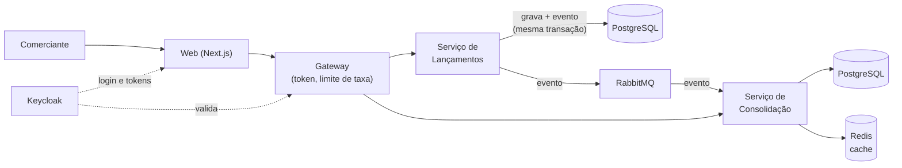

# Controle de Fluxo de Caixa (Cash Flow)

Sistema para um comerciante controlar o **fluxo de caixa diário** (lançamentos de débito e crédito) e consultar o **saldo diário consolidado**.

## O problema e a ideia central

O enunciado pede dois serviços e uma regra de ouro: **o registro de lançamentos não pode ficar indisponível se o consolidado cair**, e o consolidado deve aguentar **50 requisições por segundo com no máximo 5% de perda**.

A solução separa os dois lados e os liga por **eventos**:



- **Lançamentos** grava o lançamento e o evento **na mesma transação** (padrão *Outbox*); um *relay* publica no RabbitMQ. Se o broker ou a Consolidação caírem, o lançamento continua sendo aceito e os eventos esperam na fila.
- **Consolidação** consome os eventos de forma **idempotente** (mesmo evento entregue duas vezes conta uma vez), mantém o saldo por dia e o serve com *cache* no Redis.
- Os saldos podem ser **reconstruídos** a partir do histórico de eventos.

As decisões, com alternativas descartadas, estão nos [ADRs](docs/adr/README.md).

## Como rodar (um comando)

Sobe **tudo** em um cluster Kubernetes local de 4 nós (kind: 1 de controle e 3 workers), com serviços redundantes, autenticação, observabilidade e a aplicação web.

**Pré-requisitos:** Docker Desktop em execução (testado com ~12 GB de memória; o ambiente completo, com observabilidade, é pesado), [kind](https://kind.sigs.k8s.io/), [Helm](https://helm.sh/) e `kubectl`. No Windows: `winget install Kubernetes.kind Helm.Helm`. O `kubectl` já vem com o Docker Desktop. Os scripts são PowerShell (no Linux ou macOS, use o `pwsh`).

```powershell
./scripts/up.ps1          # cria o cluster, constrói as imagens e instala tudo (a 1ª vez leva ~10 min por causa dos downloads)
./scripts/smoke-test.ps1  # confere o sistema de ponta a ponta (35 verificações)
./scripts/down.ps1        # apaga o cluster e os dados
```

Depois de subir:

| O quê | Endereço | Acesso |
|---|---|---|
| **Aplicação web** | http://localhost:3000 | usuário `merchant1`, senha `local-dev-only` |
| API (pelo Gateway) | http://localhost:8080 | exige token (ver [05](docs/05-execucao-local.md)) |
| Keycloak (identidade) | http://localhost:8082 | |
| Grafana (painéis) | http://localhost:3030 | `admin` / `local-dev-only` |
| Jaeger (traces) | http://localhost:16686 | |

As senhas acima são **descartáveis**, existem só no ambiente local e estão no arquivo de valores do chart; nada disso vale fora dele.

**Para ver o requisito central acontecer:** abra a aplicação, registre um lançamento e veja o saldo atualizar. Depois derrube a Consolidação com `kubectl -n cashflow scale deploy/consolidation --replicas=0`, registre mais lançamentos (continuam sendo aceitos), religue com `--replicas=2` e veja o saldo alcançar tudo sozinho.

## Testes

```bash
dotnet test CashFlow.slnx                  # 254 testes: unitários e de integração (Testcontainers sobe PostgreSQL, RabbitMQ e Redis reais)
cd web && npm ci && npm test               # 45 testes do frontend
./scripts/load-test.ps1                    # carga: 50 req/s por 5 min (k6, em Docker)
./scripts/load-test.ps1 -Scenario stress   # estresse: sobe até 150 req/s
./scripts/resilience-test.ps1 -Scenario pod|consolidation|node
```

Resultados medidos (detalhes e limites em [07](docs/07-testes-de-carga-e-resiliencia.md)):

- **50 req/s por 5 min:** 15.000 leituras e 1.500 escritas, **0 falhas**; leitura p95 de 8 ms. A meta do enunciado era perda ≤ 5%.
- **150 req/s:** 34.499 leituras, **0 falhas**.
- **Consolidação fora do ar:** **100% dos lançamentos aceitos**; o saldo se recupera sozinho depois.
- **Frescor do saldo** (do lançamento ao saldo): p95 de 0,5 s.

## Documentação

| Tema | Documento |
|---|---|
| Domínios e linguagem do negócio | [01 — Mapeamento de domínios](docs/01-mapeamento-de-dominios.md) |
| Requisitos funcionais e não funcionais | [02 — Requisitos](docs/02-requisitos.md) |
| Arquitetura alvo e justificativa das tecnologias | [03 — Arquitetura alvo](docs/03-arquitetura-alvo.md), [diagramas C4](docs/architecture/c4.md), [ADRs](docs/adr/README.md) |
| Roadmap e extensão de IA | [04 — Roadmap](docs/04-roadmap.md) |
| Execução local e segurança na borda | [05 — Execução local](docs/05-execucao-local.md) |
| Observabilidade (logs, métricas, traces, alertas) | [06 — Observabilidade](docs/06-observabilidade.md) |
| Carga e resiliência | [07 — Testes de carga e resiliência](docs/07-testes-de-carga-e-resiliencia.md) |
| Aplicação web | [08 — Frontend](docs/08-frontend.md) |
| Pipelines e segurança da cadeia de suprimentos | [09 — CI/CD](docs/09-ci-cd.md) |
| Ameaças e riscos de segurança | [10 — Modelo de ameaças](docs/10-modelo-de-ameacas.md) |
| Como migrar de um sistema legado | [11 — Arquitetura de transição](docs/11-arquitetura-de-transicao.md) |
| Quanto custa | [12 — Estimativa de custos](docs/12-estimativa-de-custos.md) |
| Conferência de que o saldo bate com os lançamentos | [13 — Reconciliação](docs/13-reconciliacao.md) |
| Alta disponibilidade (PostgreSQL com failover, RabbitMQ em 3 nós) | [14 — Alta disponibilidade](docs/14-alta-disponibilidade.md) |
| Papel de Auditor (leitura restrita e rastreada) | [15 — Papel de Auditor](docs/15-papel-de-auditor.md) |
| Trilha de auditoria à prova de adulteração | [16 — Trilha de auditoria](docs/16-trilha-de-auditoria.md) |
| Isolamento de rede entre os pods | [17 — Isolamento de rede](docs/17-isolamento-de-rede.md) |
| Arquitetura de cada área (sistema, backend, frontend, banco, mensageria, IA, DevOps, infra) | [20 — Arquitetura por área](docs/20-arquitetura-por-area.md) |
| Nuvem: o que está pronto e o que falta; Terraform para o Google Cloud | [21 — Nuvem](docs/21-nuvem.md), [infra/terraform/gcp](infra/terraform/gcp/README.md) |
| **Como executar o sistema (guia do avaliador)** | [COMO-EXECUTAR.md](COMO-EXECUTAR.md) |
| Assistente de IA (rascunho de lançamento; nunca grava) | [19 — Assistente de IA](docs/19-assistente-de-ia.md) |

## Estrutura do repositório

| Pasta | Conteúdo |
|---|---|
| `docs/` | Documentação do projeto (português) |
| `src/` | Serviços em .NET: `Entries`, `Consolidation`, `Gateway` e `Shared` (observabilidade) |
| `web/` | Aplicação web em Next.js |
| `tests/` | Testes automatizados (unitários, integração, carga) |
| `deploy/` | Dockerfiles, chart Helm e configuração do kind |
| `scripts/` | `up`, `down`, `smoke-test`, `load-test`, `resilience-test` |
| `.github/` | Pipelines de CI/CD e Dependabot |

## Estado do projeto

| Fase | Escopo | Situação |
|---|---|---|
| 0 | Documentação base (domínios, requisitos, arquitetura, ADRs) | Concluída |
| 1 | Núcleo: serviços de Lançamentos e Consolidação, testes | Concluída |
| 2 | Plataforma: segurança, observabilidade, Helm/kind, carga e resiliência, frontend | Concluída |
| 3 | Diferenciais: CI/CD, ameaças, custos, transição, README | Concluída |
| 4 | Extensão: assistente de IA para rascunho de lançamentos | Concluída (v1) |
| 5 | Evoluções: mTLS, âncora externa da cadeia de auditoria e outras | Futura |

### Limitações conhecidas (por honestidade)

- **Perda de um nó inteiro ainda recusa algumas requisições** (nos testes locais, de 3% a 12% das escritas e de 0,3% a 8% das leituras) até o Kubernetes retirar o nó (~40 s): a porta de entrada local (NodePort) não tem *health check*; em nuvem o balanceador tem. Já a perda de um **pod** não recusa nada, e a do **banco primário** sozinho recusa menos de 5% das escritas (0,5% na última medição), graças ao reenvio idempotente no Gateway. Nenhum lançamento aceito se perde. Redis e Keycloak seguem em instância única (o primeiro é só cache; ver [14](docs/14-alta-disponibilidade.md)).
- **A cadeia de auditoria não é ancorada fora do banco** ([16](docs/16-trilha-de-auditoria.md)): quem apagar um lançamento *e* o último elo do comerciante, com poder total sobre o banco, não é visto. As leituras do Auditor ([15](docs/15-papel-de-auditor.md)) ficam em log e métrica.
- **Sem TLS** no ambiente local; na nuvem entram TLS na borda e mTLS entre serviços.
- **Docker Compose** do roadmap original não foi entregue: o ambiente de desenvolvimento é o próprio kind, com o mesmo chart usado na nuvem.
- **CI no GitHub:** depois das correções de 22/11 ([09](docs/09-ci-cd.md#primeira-execução-no-github-2211-o-que-apareceu-e-o-que-foi-feito)), as execuções de `ci.yml` e `security.yml` passam (confirmado pelo autor em 23/11, commit `21f692a`). O repositório é **público** desde 23/11 e o CodeQL (C# e TypeScript) rodou e concluiu sem erro de execução (Security #22, commit `b9dde0a`); dos 42 alertas iniciais do code scanning, 41 fecharam com correções (imagem do web sem npm e com `apk upgrade`, chaves de senha vazias removidas) e 1 foi dispensado como falso positivo justificado ([09](docs/09-ci-cd.md)). Hoje há 0 alertas abertos. O e2e em kind usa `-Lightweight` (sem réplicas).

## Convenções

- Documentação em português; código, commits e pipelines em inglês.
- Termos de domínio: ver o glossário em [docs/01-mapeamento-de-dominios.md](docs/01-mapeamento-de-dominios.md#7-glossário-linguagem-ubíqua).
