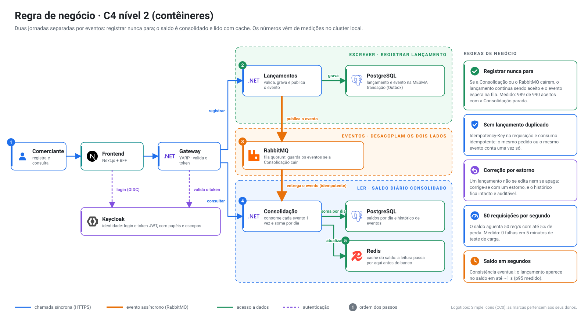
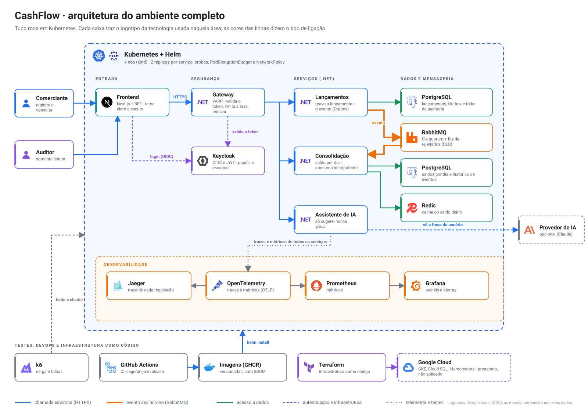
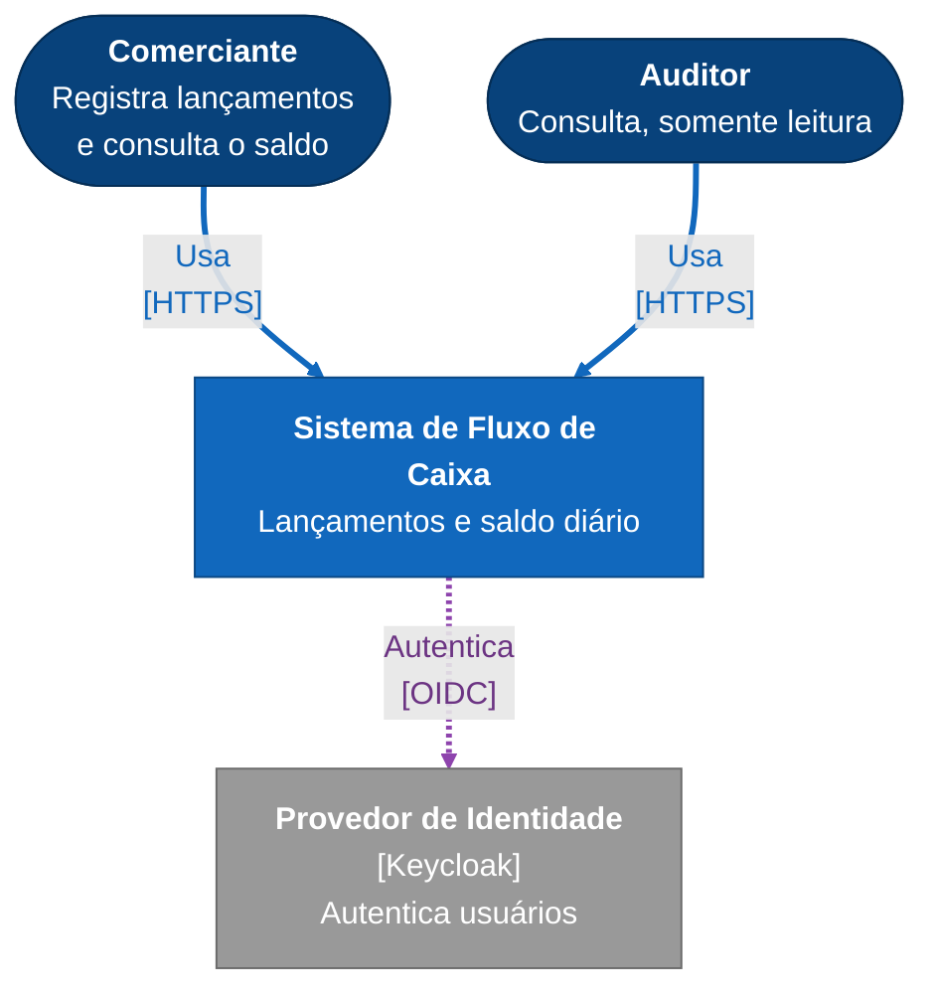
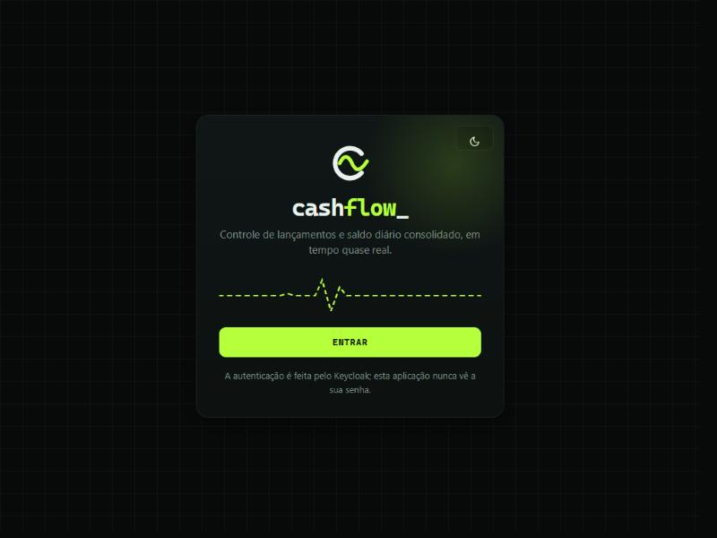
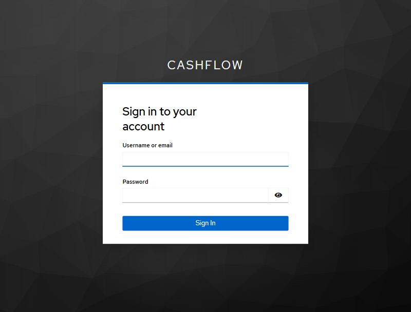
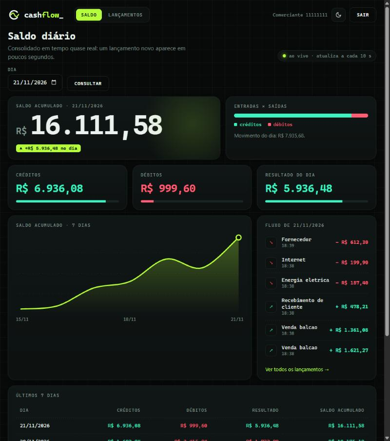
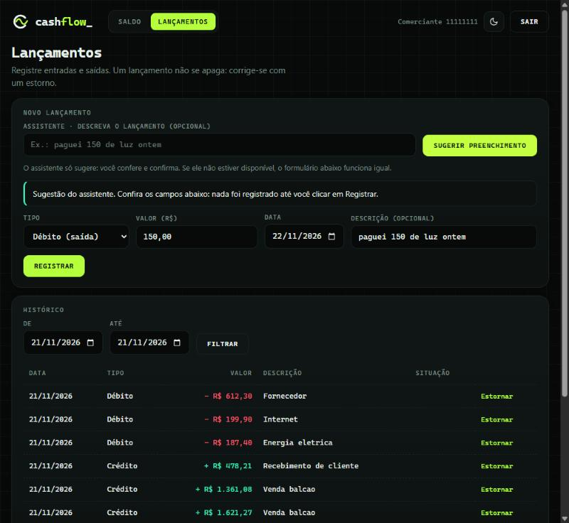
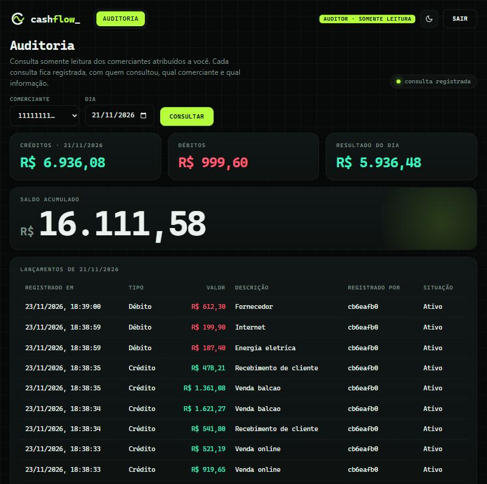
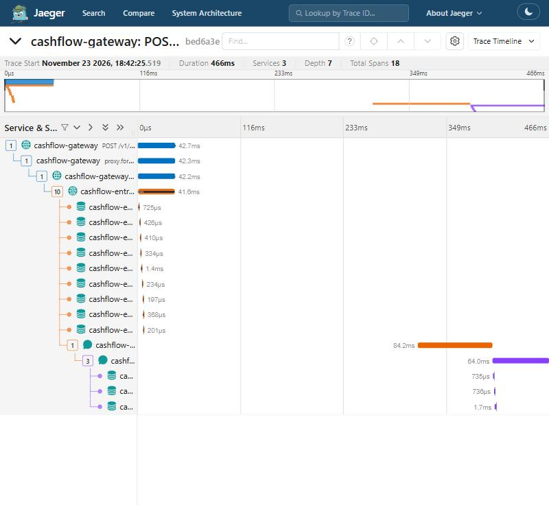
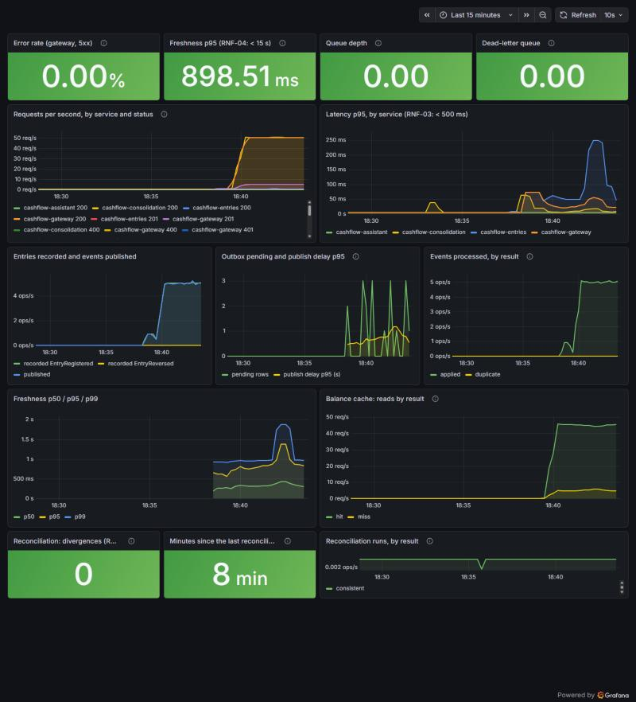

# CashFlow: controle de fluxo de caixa

Sistema para um comerciante controlar o **fluxo de caixa diário** (lançamentos de débito e crédito) e consultar o **saldo diário consolidado**.

## Em 30 segundos

| | |
|---|---|
| **O desafio** | Dois serviços e uma regra de ouro: o **registro de lançamentos não pode ficar indisponível se o consolidado cair**, e o consolidado deve aguentar **50 requisições por segundo com no máximo 5% de perda**. |
| **A solução** | Os dois lados são separados e ligados por **eventos** (RabbitMQ), com o padrão *Outbox* para nunca perder um evento. |
| **O que foi medido** | 50 req/s por 5 minutos no saldo, com **0 falhas**; com a Consolidação parada, **989 de 990** lançamentos aceitos; o lançamento aparece no saldo em menos de 1 s (p95). Detalhes em [docs/07](docs/07-testes-de-carga-e-resiliencia.md). |
| **O que existe** | Aplicação web, Gateway, três serviços .NET, dois bancos, broker, cache, identidade (Keycloak), observabilidade, CI/CD e infraestrutura como código (Terraform para o Google Cloud, validado e nunca aplicado). |
| **Por onde começar** | [COMO-EXECUTAR.md](COMO-EXECUTAR.md): do clone ao sistema rodando, em três comandos. |

## A regra de negócio (C4 nível 2)

Duas jornadas separadas por eventos. As **cores** mostram o tipo de ligação (azul: chamada síncrona; laranja: evento; verde: acesso a dados; roxo: autenticação) e os **números** mostram a ordem dos passos. [Abrir em tamanho maior](docs/imagens/regra-de-negocio-c4.svg).



1. **O comerciante registra** um crédito ou débito (ou consulta o saldo) pela aplicação web; o Gateway confere o token emitido pelo Keycloak.
2. O serviço de **Lançamentos** valida e grava o lançamento **e o evento na mesma transação** (padrão *Outbox*): nunca existe lançamento sem evento, nem evento sem lançamento.
3. Um *relay* publica o evento no **RabbitMQ**. Se o broker ou a Consolidação caírem, o lançamento continua sendo aceito e o evento espera na fila.
4. A **Consolidação** consome cada evento **uma única vez** (consumo idempotente) e soma por dia no PostgreSQL.
5. A leitura do saldo passa pelo **cache Redis**; se o valor não estiver lá, vai ao PostgreSQL. Os saldos podem ser **reconstruídos** a partir do histórico de eventos.

## Arquitetura do ambiente completo

Cada caixa traz o **logotipo da tecnologia** usada naquela área. [Abrir em tamanho maior](docs/imagens/arquitetura-ambiente.svg).



| Área | Tecnologia | Onde está |
|---|---|---|
| Frontend | Next.js 16 e React 19, com BFF; tema claro e escuro | `web/` |
| Entrada e segurança | Gateway YARP (.NET) e Keycloak (OIDC e JWT) | `src/Gateway`, [ADR-0006](docs/adr/0006-keycloak-oidc.md), [ADR-0007](docs/adr/0007-yarp-gateway.md) |
| Serviços | .NET: Lançamentos, Consolidação e Assistente de IA | `src/` |
| Mensageria | RabbitMQ, com filas *quorum* e fila de rejeitados (DLQ) | [ADR-0002](docs/adr/0002-rabbitmq-como-broker.md) |
| Dados | PostgreSQL (um por serviço, 2 instâncias cada) e Redis | [ADR-0004](docs/adr/0004-postgresql-por-servico.md), [ADR-0005](docs/adr/0005-redis-cache-de-leitura.md) |
| Observabilidade | OpenTelemetry, Jaeger, Prometheus e Grafana | [docs/06](docs/06-observabilidade.md) |
| Plataforma | Kubernetes (kind) com Helm, PodDisruptionBudget e NetworkPolicy | `deploy/`, [docs/14](docs/14-alta-disponibilidade.md), [docs/17](docs/17-isolamento-de-rede.md) |
| DevOps | GitHub Actions (CI, CodeQL, Trivy, gitleaks, release) e Dependabot | `.github/`, [docs/09](docs/09-ci-cd.md) |
| Infraestrutura como código | Terraform para o Google Cloud (validado, nunca aplicado) | `infra/terraform/gcp`, [docs/21](docs/21-nuvem.md) |
| Testes | xUnit com Testcontainers, Vitest, k6 e verificação de ponta a ponta | `tests/`, `scripts/` |

## C4: contexto do sistema (nível 1)

Quem usa o sistema e com o que ele conversa por fora. Os níveis 2 e 3 (contêineres e componentes) e a implantação estão em [docs/architecture/c4.md](docs/architecture/c4.md).



## O sistema em funcionamento

Capturas do ambiente local, com dados de demonstração. A interface tem **tema escuro e claro**.

| | |
|---|---|
| <br>**Entrada.** A autenticação é do Keycloak; a aplicação nunca vê a senha. | <br>**Keycloak.** Página de login do realm `cashflow` (OIDC). |
| <br>**Saldo diário.** Saldo acumulado, créditos, débitos, gráfico de 7 dias e o fluxo do dia; atualiza sozinho a cada 10 s. | <br>**Lançamentos.** O assistente lê uma frase e **só preenche o formulário**; quem grava é o usuário. |
| <br>**Auditor.** Somente leitura, apenas dos comerciantes atribuídos a ele; cada consulta fica registrada. | |

## Ferramentas de operação

Todas rodam no próprio cluster local. Usuários e senhas existem **só nesta máquina** (ambiente de desenvolvimento).

| Ferramenta | Endereço | Acesso | Para quê |
|---|---|---|---|
| Aplicação web | http://localhost:3000 | `merchant1` ou `auditor1` / `local-dev-only` | Usar o sistema |
| API (Gateway) | http://localhost:8080 | token do Keycloak ([exemplo](COMO-EXECUTAR.md)) | Integração |
| Keycloak | http://localhost:8082 | `admin` / `local-dev-only` | Identidade, papéis e escopos |
| Grafana | http://localhost:3030 | `admin` / `local-dev-only` | Painéis e alertas |
| Jaeger | http://localhost:16686 | sem login | Trace de cada requisição |

| | |
|---|---|
| <br>**Jaeger.** Um lançamento atravessa o Gateway, o serviço de Lançamentos (com as gravações no banco) e a publicação e o consumo no broker: 3 serviços e 18 spans. | <br>**Grafana.** Painel "Cash Flow: SLOs and flow" durante um teste de carga de 50 req/s: erro 0%, fila e fila de rejeitados em zero. |

## Kubernetes

Saída real do cluster local (resumida às colunas principais): 4 nós, e cada serviço com 2 réplicas.

```text
$ kubectl get nodes
NAME                     STATUS   ROLES           VERSION
cashflow-control-plane   Ready    control-plane   v1.37.0
cashflow-worker          Ready    <none>          v1.37.0
cashflow-worker2         Ready    <none>          v1.37.0
cashflow-worker3         Ready    <none>          v1.37.0

$ kubectl -n cashflow get pods
NAME                             READY   STATUS
assistant-58f5c5b769-5x4lh       1/1     Running
assistant-58f5c5b769-qqtk5       1/1     Running
consolidation-5bd94f64d9-kbbpl   1/1     Running
consolidation-5bd94f64d9-pb68s   1/1     Running
entries-76758658db-llfvd         1/1     Running
entries-76758658db-qtl8z         1/1     Running
gateway-5cd4d5cd5c-nxjkd         1/1     Running
gateway-5cd4d5cd5c-xjq6r         1/1     Running
grafana-548c5c5ddb-lg2fs         1/1     Running
jaeger-84dcc4f467-p6znd          1/1     Running
keycloak-59f7bdd78c-9cmhk        1/1     Running
postgres-consolidation-1         1/1     Running
postgres-consolidation-2         1/1     Running
postgres-entries-1               1/1     Running
postgres-entries-2               1/1     Running
prometheus-65fcbfc9c8-sfm65      1/1     Running
rabbitmq-0                       1/1     Running
rabbitmq-1                       1/1     Running
rabbitmq-2                       1/1     Running
redis-7784cdb879-cl5wr           1/1     Running
web-68b649fbc5-p4w2f             1/1     Running
web-68b649fbc5-xcwds             1/1     Running
```

- **Resiliência:** réplicas espalhadas entre os nós, *probes*, atualização sem indisponibilidade e **8 PodDisruptionBudgets**; o PostgreSQL tem réplica síncrona e o RabbitMQ roda com 3 nós. Provas em [docs/14](docs/14-alta-disponibilidade.md).
- **Isolamento:** **10 NetworkPolicies**, com tráfego de entrada negado por padrão: cada serviço só recebe de quem precisa ([docs/17](docs/17-isolamento-de-rede.md)).
- **Escala:** o autoescalonamento (HPA) existe no chart, mas está desligado localmente.
- **Empacotamento:** um único chart Helm (`deploy/helm/cashflow`), com valores para o ambiente local e para a nuvem.

## A ideia central, em detalhe

- **Lançamentos** grava o lançamento e o evento **na mesma transação** (padrão *Outbox*); um *relay* publica no RabbitMQ. Se o broker ou a Consolidação caírem, o lançamento continua sendo aceito e os eventos esperam na fila.
- **Consolidação** consome os eventos de forma **idempotente** (mesmo evento entregue duas vezes conta uma vez), mantém o saldo por dia e o serve com *cache* no Redis.
- Os saldos podem ser **reconstruídos** a partir do histórico de eventos.

As decisões, com alternativas descartadas, estão nos [ADRs](docs/adr/README.md).

## Como rodar (um comando)

Sobe **tudo** em um cluster Kubernetes local de 4 nós (kind: 1 de controle e 3 workers), com serviços redundantes, autenticação, observabilidade e a aplicação web.

**Pré-requisitos:** Docker Desktop em execução (testado com ~12 GB de memória; o ambiente completo, com observabilidade, é pesado), [kind](https://kind.sigs.k8s.io/), [Helm](https://helm.sh/) e `kubectl`. No Windows: `winget install Kubernetes.kind Helm.Helm`. O `kubectl` já vem com o Docker Desktop. Os scripts são PowerShell (no Linux ou macOS, use o `pwsh`).

```powershell
./scripts/up.ps1          # cria o cluster, constrói as imagens e instala tudo (a 1ª vez leva ~10 min por causa dos downloads)
./scripts/smoke-test.ps1  # confere o sistema de ponta a ponta (35 verificações)
./scripts/down.ps1        # apaga o cluster e os dados
```

Depois de subir:

| O quê | Endereço | Acesso |
|---|---|---|
| **Aplicação web** | http://localhost:3000 | usuário `merchant1`, senha `local-dev-only` |
| API (pelo Gateway) | http://localhost:8080 | exige token (ver [05](docs/05-execucao-local.md)) |
| Keycloak (identidade) | http://localhost:8082 | |
| Grafana (painéis) | http://localhost:3030 | `admin` / `local-dev-only` |
| Jaeger (traces) | http://localhost:16686 | |

As senhas acima são **descartáveis**, existem só no ambiente local e estão no arquivo de valores do chart; nada disso vale fora dele.

**Para ver o requisito central acontecer:** abra a aplicação, registre um lançamento e veja o saldo atualizar. Depois derrube a Consolidação com `kubectl -n cashflow scale deploy/consolidation --replicas=0`, registre mais lançamentos (continuam sendo aceitos), religue com `--replicas=2` e veja o saldo alcançar tudo sozinho.

## Testes

```bash
dotnet test CashFlow.slnx                  # 254 testes: unitários e de integração (Testcontainers sobe PostgreSQL, RabbitMQ e Redis reais)
cd web && npm ci && npm test               # 45 testes do frontend
./scripts/load-test.ps1                    # carga: 50 req/s por 5 min (k6, em Docker)
./scripts/load-test.ps1 -Scenario stress   # estresse: sobe até 150 req/s
./scripts/resilience-test.ps1 -Scenario pod|consolidation|node
```

Resultados medidos (detalhes e limites em [07](docs/07-testes-de-carga-e-resiliencia.md)):

- **50 req/s por 5 min:** 15.000 leituras e 1.500 escritas, **0 falhas**; leitura p95 de 8 ms. A meta do enunciado era perda ≤ 5%.
- **150 req/s:** 34.499 leituras, **0 falhas**.
- **Consolidação fora do ar:** **100% dos lançamentos aceitos**; o saldo se recupera sozinho depois.
- **Frescor do saldo** (do lançamento ao saldo): p95 de 0,5 s.

## Documentação

| Tema | Documento |
|---|---|
| Domínios e linguagem do negócio | [01 — Mapeamento de domínios](docs/01-mapeamento-de-dominios.md) |
| Requisitos funcionais e não funcionais | [02 — Requisitos](docs/02-requisitos.md) |
| Arquitetura alvo e justificativa das tecnologias | [03 — Arquitetura alvo](docs/03-arquitetura-alvo.md), [diagramas C4](docs/architecture/c4.md), [ADRs](docs/adr/README.md) |
| Roadmap e extensão de IA | [04 — Roadmap](docs/04-roadmap.md) |
| Execução local e segurança na borda | [05 — Execução local](docs/05-execucao-local.md) |
| Observabilidade (logs, métricas, traces, alertas) | [06 — Observabilidade](docs/06-observabilidade.md) |
| Carga e resiliência | [07 — Testes de carga e resiliência](docs/07-testes-de-carga-e-resiliencia.md) |
| Aplicação web | [08 — Frontend](docs/08-frontend.md) |
| Pipelines e segurança da cadeia de suprimentos | [09 — CI/CD](docs/09-ci-cd.md) |
| Ameaças e riscos de segurança | [10 — Modelo de ameaças](docs/10-modelo-de-ameacas.md) |
| Como migrar de um sistema legado | [11 — Arquitetura de transição](docs/11-arquitetura-de-transicao.md) |
| Quanto custa | [12 — Estimativa de custos](docs/12-estimativa-de-custos.md) |
| Conferência de que o saldo bate com os lançamentos | [13 — Reconciliação](docs/13-reconciliacao.md) |
| Alta disponibilidade (PostgreSQL com failover, RabbitMQ em 3 nós) | [14 — Alta disponibilidade](docs/14-alta-disponibilidade.md) |
| Papel de Auditor (leitura restrita e rastreada) | [15 — Papel de Auditor](docs/15-papel-de-auditor.md) |
| Trilha de auditoria à prova de adulteração | [16 — Trilha de auditoria](docs/16-trilha-de-auditoria.md) |
| Isolamento de rede entre os pods | [17 — Isolamento de rede](docs/17-isolamento-de-rede.md) |
| Arquitetura de cada área (sistema, backend, frontend, banco, mensageria, IA, DevOps, infra) | [20 — Arquitetura por área](docs/20-arquitetura-por-area.md) |
| Nuvem: o que está pronto e o que falta; Terraform para o Google Cloud | [21 — Nuvem](docs/21-nuvem.md), [infra/terraform/gcp](infra/terraform/gcp/README.md) |
| **Como executar o sistema (guia do avaliador)** | [COMO-EXECUTAR.md](COMO-EXECUTAR.md) |
| Assistente de IA (rascunho de lançamento; nunca grava) | [19 — Assistente de IA](docs/19-assistente-de-ia.md) |

## Estrutura do repositório

| Pasta | Conteúdo |
|---|---|
| `docs/` | Documentação do projeto (português); `docs/imagens/` tem os diagramas e as capturas de tela deste README |
| `src/` | Serviços em .NET: `Entries`, `Consolidation`, `Assistant`, `Gateway` e `Shared` (segurança e observabilidade) |
| `web/` | Aplicação web em Next.js |
| `tests/` | Testes automatizados (unitários, integração, carga) |
| `deploy/` | Dockerfiles, chart Helm e configuração do kind |
| `infra/` | Terraform para o Google Cloud (validado, nunca aplicado) |
| `scripts/` | `up`, `down`, `smoke-test`, `load-test`, `resilience-test` |
| `.github/` | Pipelines de CI/CD e Dependabot |

## Estado do projeto

| Fase | Escopo | Situação |
|---|---|---|
| 0 | Documentação base (domínios, requisitos, arquitetura, ADRs) | Concluída |
| 1 | Núcleo: serviços de Lançamentos e Consolidação, testes | Concluída |
| 2 | Plataforma: segurança, observabilidade, Helm/kind, carga e resiliência, frontend | Concluída |
| 3 | Diferenciais: CI/CD, ameaças, custos, transição, README | Concluída |
| 4 | Extensão: assistente de IA para rascunho de lançamentos | Concluída (v1) |
| 5 | Evoluções: mTLS, âncora externa da cadeia de auditoria e outras | Futura |

### Limitações conhecidas (por honestidade)

- **Perda de um nó inteiro ainda recusa algumas requisições** (nos testes locais, de 3% a 12% das escritas e de 0,3% a 8% das leituras) até o Kubernetes retirar o nó (~40 s): a porta de entrada local (NodePort) não tem *health check*; em nuvem o balanceador tem. Já a perda de um **pod** não recusa nada, e a do **banco primário** sozinho recusa menos de 5% das escritas (0,5% na última medição), graças ao reenvio idempotente no Gateway. Nenhum lançamento aceito se perde. Redis e Keycloak seguem em instância única (o primeiro é só cache; ver [14](docs/14-alta-disponibilidade.md)).
- **A cadeia de auditoria não é ancorada fora do banco** ([16](docs/16-trilha-de-auditoria.md)): quem apagar um lançamento *e* o último elo do comerciante, com poder total sobre o banco, não é visto. As leituras do Auditor ([15](docs/15-papel-de-auditor.md)) ficam em log e métrica.
- **Sem TLS** no ambiente local; na nuvem entram TLS na borda e mTLS entre serviços.
- **Docker Compose** do roadmap original não foi entregue: o ambiente de desenvolvimento é o próprio kind, com o mesmo chart usado na nuvem.
- **CI no GitHub:** depois das correções de 22/11 ([09](docs/09-ci-cd.md#primeira-execução-no-github-2211-o-que-apareceu-e-o-que-foi-feito)), as execuções de `ci.yml` e `security.yml` passam (confirmado pelo autor em 23/11, commit `21f692a`). O repositório é **público** desde 23/11 e o CodeQL (C# e TypeScript) rodou e concluiu sem erro de execução (Security #22, commit `b9dde0a`); dos 42 alertas iniciais do code scanning, 41 fecharam com correções (imagem do web sem npm e com `apk upgrade`, chaves de senha vazias removidas) e 1 foi dispensado como falso positivo justificado ([09](docs/09-ci-cd.md)). Hoje há 0 alertas abertos. O e2e em kind usa `-Lightweight` (sem réplicas).

## Convenções

- Documentação em português; código, commits e pipelines em inglês.
- Termos de domínio: ver o glossário em [docs/01-mapeamento-de-dominios.md](docs/01-mapeamento-de-dominios.md#7-glossário-linguagem-ubíqua).
