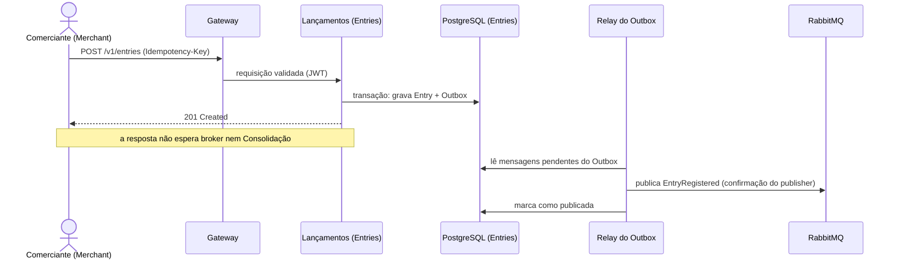
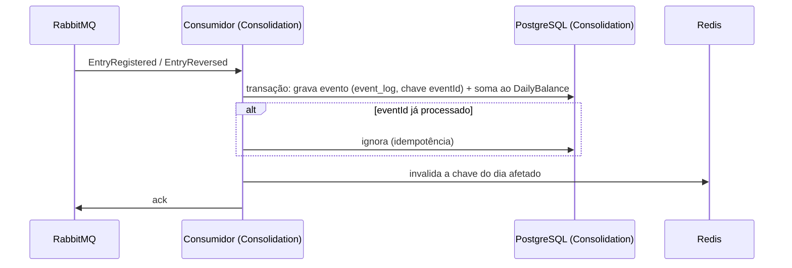
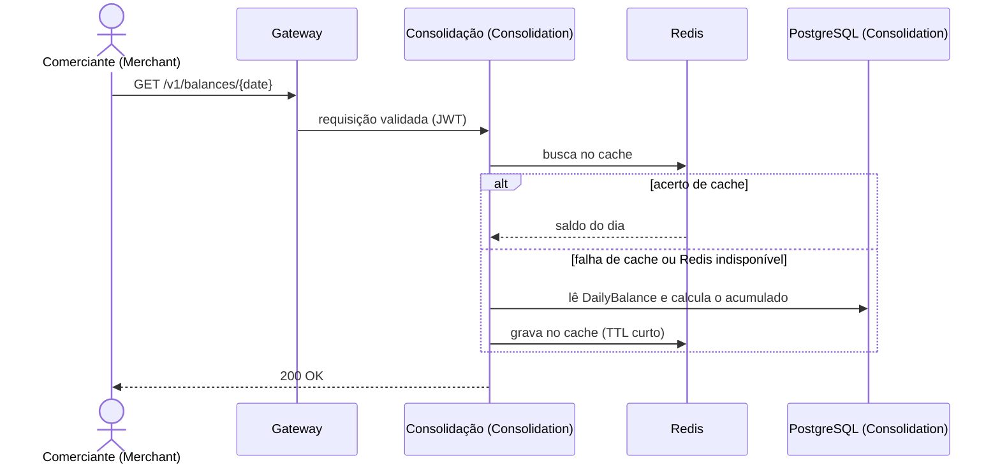

# 03 — Arquitetura Alvo

> Convenção: documentação em português; termos de domínio como *Nome (Name)*; código em inglês. Diagramas C4 em [architecture/c4.md](architecture/c4.md). Decisões detalhadas em [adr/](adr/).

## 1. Estilo arquitetural

**Dois serviços orientados a eventos, com CQRS leve (Command Query Responsibility Segregation).**

- **Lançamentos (Entries):** lado de escrita. Fonte da verdade dos lançamentos.
- **Consolidação (Consolidation):** lado de leitura. Projeção do saldo diário, alimentada por eventos.
- A comunicação entre eles é **assíncrona** (RabbitMQ). Nenhum serviço chama o outro de forma síncrona.

| Alternativa avaliada | Motivo do descarte |
|---|---|
| Monólito modular | Um processo só cai junto; não comprova fisicamente o isolamento de falha (RNF-01). |
| Chamada síncrona Lançamentos → Consolidação | Acopla a disponibilidade dos dois, o oposto do que o enunciado exige. |
| Microsserviços granulares (5 ou mais) | Complexidade sem benefício para duas capacidades core. |
| Serverless | Adequado à nuvem, mas pior para execução local em Kubernetes e para depuração. |

Justificativa completa: [ADR-0001](adr/0001-servicos-orientados-a-eventos.md).

## 2. Decomposição

Os contextos e capacidades estão em [01 — Mapeamento de domínios](01-mapeamento-de-dominios.md). Esta visão os leva a contêineres:

| Contêiner | Responsabilidade | Tecnologia |
|---|---|---|
| Frontend (Web) | Interface do comerciante e do auditor; *server components* chamam o Gateway com o token na sessão do servidor | Next.js (App Router) |
| Gateway (API Gateway) | Roteamento, validação de JWT, limitação de taxa, correlation ID | YARP (.NET) |
| Serviço de Lançamentos (Entries Service) | Registrar, estornar e consultar lançamentos; Outbox | .NET 10 (LTS), PostgreSQL |
| Serviço de Consolidação (Consolidation Service) | Consumir eventos, manter o saldo diário, servir consultas, reprocessar | .NET 10 (LTS), PostgreSQL, Redis |
| Provedor de identidade (Identity Provider) | OIDC, emissão de tokens, papéis | Keycloak |
| Broker de mensagens (Message Broker) | Entrega durável e assíncrona dos eventos | RabbitMQ |
| Observabilidade (Observability) | Métricas, traces e logs | OpenTelemetry, Prometheus, Grafana, Jaeger |

## 3. Interfaces (API)

Todas sob o prefixo `/v1`, autenticadas por JWT.

| Método e rota | Serviço | Papel / escopo |
|---|---|---|
| `POST /v1/entries` (com `Idempotency-Key`) | Lançamentos | Merchant — `entries:write` |
| `POST /v1/entries/{id}/reversals` | Lançamentos | Merchant — `entries:write` |
| `GET /v1/entries?from=&to=&page=` | Lançamentos | Merchant — `entries:read`; Auditor — `entries:audit` + `merchantId` |
| `GET /v1/entries/{id}` | Lançamentos | Merchant — `entries:read`; Auditor — `entries:audit` + `merchantId` |
| `GET /v1/balances/{date}` | Consolidação | Merchant — `balances:read`; Auditor — `balances:audit` + `merchantId` |
| `GET /v1/balances?from=&to=` (máx. 366 dias) | Consolidação | Merchant — `balances:read`; Auditor — `balances:audit` + `merchantId` |
| `POST /v1/balances/rebuild` | Consolidação | Administrativo — `balances:rebuild` |

O comerciante só acessa o próprio `merchantId`, extraído de um *claim* do token; pedir outro é recusado (403). O Auditor lê **somente** os comerciantes atribuídos a ele no token (`audit_merchants`), nomeando um por requisição, e cada leitura é registrada: ver [15](15-papel-de-auditor.md).

## 4. Fluxos principais

### 4.1 Escrita (registrar lançamento)

### 4.2 Atualização do saldo (consumo)

### 4.3 Leitura (consultar saldo)

## 5. Contrato do evento (Linguagem Publicada / Published Language)

Evento em JSON, com versão de esquema. Mudanças compatíveis acrescentam campos; mudanças incompatíveis geram uma nova versão do tipo.

| Campo | Descrição |
|---|---|
| `eventId` | UUID único do evento. Chave de idempotência do consumidor. |
| `eventType` | `EntryRegistered` ou `EntryReversed` |
| `schemaVersion` | Versão do esquema (inicia em `1`) |
| `occurredAt` | Instante UTC em que o fato ocorreu |
| `merchantId` | Comerciante dono do lançamento |
| `entryId` | Identificador do lançamento (no estorno, o lançamento compensatório) |
| `type` | `Debit` ou `Credit` |
| `amount` | Valor decimal positivo |
| `entryDate` | Dia de competência (data, sem horário) |
| `originalEntryId` | Apenas em `EntryReversed`: o lançamento estornado |
| `createdBy` | Quem registrou (ou, no estorno, quem estornou): o `sub` do token. Campo acrescentado sem mudar a `schemaVersion`, pois consumidores ignoram campos desconhecidos |

**Decisão de modelagem:** o lançamento compensatório de um estorno herda o `entryDate` do original, de modo que o saldo do dia original é corrigido (coerente com a decisão 4 do mapeamento, lançamentos retroativos).

## 6. Consistência, idempotência e reprocessamento

- **Soma é comutativa.** Atualizar o saldo é somar créditos ou débitos. Por isso a **ordem de entrega não importa**; só a idempotência importa. Isso dispensa partições ordenadas e simplifica o broker.
- **Entrega *at least once*** (Outbox + confirmação do publisher + ack manual). Duplicatas são esperadas e tratadas.
- **Idempotência do consumidor:** o registro de eventos (`event_log`) tem o `eventId` como chave primária. A gravação usa `INSERT ... ON CONFLICT DO NOTHING` **na mesma transação** que o incremento do saldo: se nenhuma linha for inserida, o evento é duplicado e nada muda. O incremento é atômico no banco (`SET credits = credits + x`), sem perda de atualização em concorrência. Um bloqueio consultivo (*advisory lock*) compartilhado por comerciante permite aplicar eventos em paralelo e é exclusivo apenas durante um reprocessamento.
- **Falhas de processamento:** mensagem **inválida** (JSON malformado, versão de contrato desconhecida, valor inválido) vai direto para a fila de mensagens mortas (*dead-letter queue*, `consolidation.entries.dlq`), com alerta. Falha **transitória** (por exemplo, banco indisponível) devolve a mensagem à fila após uma pausa, sem perder o evento nem enviá-lo à DLQ.
- **Saldo acumulado** é calculado na leitura somando os líquidos diários até a data (índice por `merchantId` e data), com cache. O cache usa uma **versão por comerciante**: cada evento incrementa a versão, o que invalida de uma vez todos os saldos em cache do comerciante (um evento retroativo muda o acumulado dos dias seguintes). Se o Redis falhar, a leitura vai ao banco.
- **Registro de eventos (event log):** o Consolidado guarda os eventos recebidos. O reprocessamento (RF-08) reconstrói o `DailyBalance` a partir desse registro, sem consultar o serviço de Lançamentos, preservando o desacoplamento. Ver [ADR-0010](adr/0010-reprocessamento-por-registro-de-eventos.md).
- **Reconciliação (RNF-07):** um job periódico compara (A) o que o serviço de Lançamentos registrou com o registro de eventos e (B) o registro de eventos com os saldos guardados, e alerta em caso de divergência. Detalhes em [13](13-reconciliacao.md).

## 7. Como a arquitetura atende aos requisitos não funcionais

| RNF | Mecanismo |
|---|---|
| RNF-01 Isolamento de falha | Escrita termina no banco local (Entry + Outbox). Sem chamada síncrona ao Consolidado. Se ele cair, as mensagens ficam na fila e são consumidas na volta. |
| RNF-02 50 req/s, perda ≤ 5% | Leitura servida pelo Redis ou por uma consulta indexada; saldo pré-calculado; réplicas do serviço; consulta com *fallback* ao banco. |
| RNF-03 Latência | Cache, índice por `merchantId` e data, serviços sem estado. |
| RNF-04 Frescor | Consumo contínuo com *prefetch*; meta monitorada pelo atraso da fila e por uma métrica de ponta a ponta. |
| RNF-05 Disponibilidade | Réplicas, *probes*, *PodDisruptionBudget*; a camada 2 ([14](14-alta-disponibilidade.md)) replica PostgreSQL e RabbitMQ. |
| RNF-06 Durabilidade | Filas e mensagens duráveis, publicação confirmada, Outbox transacional, backups do PostgreSQL. |
| RNF-07 Correção | Idempotência atômica, reconciliação, reprocessamento. |
| RNF-08 Segurança | Ver seção 8. |
| RNF-09 Observabilidade | Ver seção 9. |
| RNF-10 Escalabilidade | Serviços sem estado, consumidores concorrentes na mesma fila e HPA (existe no chart, desligado localmente). |
| RNF-12/13 Portabilidade e redundância | Helm, kind, ≥ 2 réplicas. Ver seção 10. |

### Modos de falha

| Falha | Efeito | Resposta do sistema |
|---|---|---|
| Consolidação fora do ar | Saldos ficam desatualizados | Lançamentos segue 100%; mensagens acumulam e são processadas na volta. |
| RabbitMQ fora do ar | Eventos não são publicados | Escrita continua; o Outbox acumula e o *relay* retoma. |
| Redis fora do ar | Maior latência | *Fallback* ao PostgreSQL; sem indisponibilidade. |
| PostgreSQL de Consolidação fora do ar | Leituras e consumo param | Cache atende parte das leituras; mensagens esperam na fila. |
| PostgreSQL de Lançamentos fora do ar | Escrita indisponível | Falha isolada ao serviço de Lançamentos; a réplica síncrona e o failover automático da camada 2 reduzem o risco (falha de cerca de 17 s medida na perda do nó). |
| Mensagem inválida (*poison*) | Bloquearia a fila | Vai para a DLQ após tentativas, com alerta. |

## 8. Segurança

Detalhes em [ADR-0006](adr/0006-keycloak-oidc.md) e [ADR-0007](adr/0007-yarp-gateway.md).

- **Identidade:** Keycloak (OIDC). Usuários autenticam com *authorization code + PKCE* no servidor do Next.js; o token fica na sessão do servidor, não no navegador.
- **Consumo de serviços (integração):** *client credentials* para chamadas máquina a máquina; escopos mínimos por serviço (`entries:write`, `entries:read`, `balances:read`, `balances:rebuild`).
- **Defesa em profundidade:** o Gateway valida o JWT e **cada serviço valida de novo** (não confia na rede interna).
- **Isolamento de dados:** `merchantId` vem do token; o filtro é aplicado em toda consulta.
- **Proteção da API:** TLS na borda, limitação de taxa (limite acima do pico legítimo, pois 429 conta como perda), validação de entrada, tamanho máximo de corpo, cabeçalhos de segurança.
- **Dados e operação:** segredos fora do código (Secrets do Kubernetes; gerenciador de segredos na nuvem), privilégio mínimo no banco, trilha de auditoria de operações de escrita e de reprocessamento, tratamento de dados pessoais conforme a LGPD (o modelo guarda o mínimo necessário).
- **Cadeia de suprimentos:** análise estática (CodeQL), verificação de dependências, varredura de segredos e de imagens no pipeline (ver documento de CI/CD).
- **Evolução:** mTLS entre serviços (malha de serviço).

## 9. Observabilidade

- **OpenTelemetry** nos dois serviços e no Gateway: traces com *correlation ID* propagado também nas mensagens, métricas e logs estruturados.
- **Prometheus + Grafana:** painéis dos SLOs (latência, taxa de erro, vazão), atraso da fila, tamanho do Outbox, DLQ, taxa de acerto do cache.
- **Jaeger:** traces ponta a ponta, do `POST` até a atualização do saldo.
- **Alertas:** taxa de erro, p95 acima da meta, atraso da fila acima da meta de frescor, mensagens na DLQ, divergência na reconciliação.
- **Verificações de saúde:** *liveness* e *readiness* distintas; *readiness* considera as dependências críticas de cada serviço.

## 10. Implantação

Visão de implantação em [architecture/c4.md](architecture/c4.md#implantação-deployment).

- **Dois modos, mesmas imagens:** Compose para desenvolvimento; Kubernetes local (kind, 4 nós) com **Helm** para o ambiente redundante.
- **Camada 1 (entrega do desafio):** serviços .NET e Gateway com ≥ 2 réplicas, *anti-affinity*, *probes*, *PodDisruptionBudget* e *rolling update* (o HPA existe no chart, desligado localmente); dependências em instância única.
- **Camada 2 (entregue, [14](14-alta-disponibilidade.md)):** PostgreSQL com primário e réplica síncrona e failover automático (CloudNativePG, operador replicado), RabbitMQ em 3 nós com *quorum queues*. Redis segue único (é só *cache*) e o Keycloak também.
- **Nuvem:** os mesmos charts, com `values` próprios; dependências substituídas por serviços gerenciados (banco multi-AZ, broker e cache gerenciados). Infraestrutura como código (Terraform) descrita como evolução.
- **Automação:** um único script (`up.ps1`/`up.sh`) cria o cluster, constrói as imagens, instala dependências e charts e espera o ambiente ficar pronto.

## 11. Tecnologias e justificativas

| Escolha | Justificativa | Decisão |
|---|---|---|
| .NET 10 (LTS) | Linguagem de domínio do autor; desempenho; suporte de longo prazo | — |
| Next.js | Interface com *server components*; token fora do navegador | — |
| RabbitMQ | Simplicidade operacional; *quorum queues* para alta disponibilidade; suficiente para ~20 req/s | [ADR-0002](adr/0002-rabbitmq-como-broker.md) |
| Outbox | Evita perder evento se o broker falhar | [ADR-0003](adr/0003-padrao-outbox.md) |
| PostgreSQL por serviço | Transações, maturidade, banco isolado por contexto | [ADR-0004](adr/0004-postgresql-por-servico.md) |
| Redis | Cache de leitura com *fallback* | [ADR-0005](adr/0005-redis-cache-de-leitura.md) |
| Keycloak | Padrão OIDC sem construir identidade | [ADR-0006](adr/0006-keycloak-oidc.md) |
| YARP | Gateway leve, nativo do ecossistema .NET | [ADR-0007](adr/0007-yarp-gateway.md) |
| Helm + kind | Pacote reutilizável; cluster local multi-nó | [ADR-0008](adr/0008-helm-e-kind.md) |
| OpenTelemetry + stack aberta | Padrão aberto, sem dependência de fornecedor | [ADR-0009](adr/0009-observabilidade-opentelemetry.md) |

## 12. Riscos e trade-offs assumidos

- **Consistência eventual:** o saldo pode estar alguns segundos defasado. Aceitável para consolidação diária (RNF-04) e comunicado na interface.
- **Mais peças operacionais** (broker, cache, identidade) que um monólito. Mitigado por automação e observabilidade.
- **Cliente RabbitMQ próprio:** evita licença comercial de bibliotecas de mensageria, ao custo de código de infraestrutura que precisa de testes próprios.
- **Keycloak em instância única:** sem ele não se emitem tokens novos; ver [14](14-alta-disponibilidade.md).

## 13. Evoluções futuras

mTLS e malha de serviço; GitOps (Argo CD); Terraform para a nuvem; saldo acumulado materializado (*snapshots*) para históricos longos; multimoeda; categorias de lançamento; conciliação bancária; restrição do Auditor por atribuição; arquitetura de transição para legado (documento próprio).
