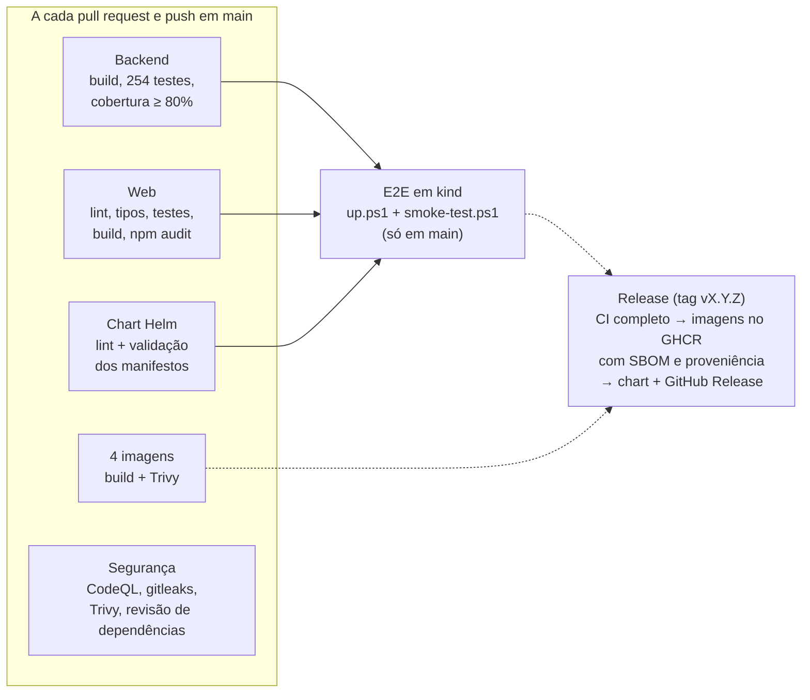

# 09 — CI/CD e segurança da cadeia de suprimentos

Pipelines do GitHub Actions em `.github/workflows/`. A ideia central: **o que roda no pipeline é o que o desenvolvedor roda na própria máquina**, com os mesmos scripts, para não existir "funciona só no CI".



## Workflows

| Arquivo | Quando roda | O que garante |
|---|---|---|
| `ci.yml` | pull request, push em `main`, manual, e chamado pela release | Compila com avisos como erro, roda **todos os testes** (inclusive os de integração, com PostgreSQL, RabbitMQ e Redis reais via Testcontainers), exige **≥ 80% de cobertura de linhas no domínio e na aplicação** (RNF-11), valida o front (lint, tipos, testes, build, `npm audit`), valida o chart contra os esquemas do Kubernetes e constrói as 4 imagens varrendo vulnerabilidades críticas. Em `main`, sobe o sistema inteiro num cluster kind de 3 nós e roda o *smoke test*. |
| `security.yml` | pull request, push em `main`, **toda segunda-feira**, manual | CodeQL (C# e TypeScript, consultas `security-extended`), varredura de segredos em **todo o histórico** (gitleaks), vulnerabilidades e más configurações em dependências, Dockerfiles e Helm (Trivy), e revisão de dependências nova em pull requests. A execução semanal existe porque vulnerabilidades novas surgem mesmo sem mudança no código. |
| `release.yml` | tag `vX.Y.Z` | Roda o CI completo; **só se passar** publica as 4 imagens no GitHub Container Registry com **proveniência de build e SBOM** anexados, empacota o chart e cria a release no GitHub. |
| `dependabot.yml` | mensal | Pull requests de atualização de NuGet, npm e das próprias *actions*, **sem versões maiores** em NuGet e npm (uma versão maior é uma migração a planejar, não uma atualização de rotina); cada um passa pelo CI inteiro antes de poder ser aceito. |

## O ambiente de ponta a ponta no CI

O job `e2e` executa `./scripts/up.ps1 -NoObservability -Lightweight` (cria o cluster kind, constrói as imagens, instala o chart e espera tudo ficar pronto) e depois `./scripts/smoke-test.ps1`. São exatamente os scripts que um desenvolvedor usa; as diferenças são deixar de fora Jaeger, Prometheus e Grafana e rodar banco e broker **sem réplicas** (`-Lightweight`), porque o executor tem pouca memória; a configuração replicada ([14](14-alta-disponibilidade.md)) é testada localmente.

O `smoke-test.ps1` (35 verificações, também útil localmente) confere:

- **Controle de acesso:** sem token e com token falso dão 401; o token do comerciante lê saldo; o token de operação não lê saldo (403); o do comerciante não reprocessa (403).
- **Lançamento:** registra (201) e grava como autor o `sub` do token; repetir a mesma `Idempotency-Key` devolve o mesmo lançamento, sinalizado como repetição.
- **Saldo:** o crédito chega ao saldo consolidado e é contado **exatamente uma vez**.
- **Tokens de quem entra pela tela:** pergunta ao Keycloak o que ele poria no token de `merchant1` e de `auditor1` para o cliente web (tem `sub`, `merchant_id`, audiência, escopos, atribuição do Auditor). Existe porque um token sem `sub` fez todo registro pela tela falhar com 403 e as verificações de máquina a máquina não viam isso.
- **Assistente:** uma frase vira rascunho, uma ambígua vira pergunta, uma ordem ao assistente é recusada, pedir rascunho **não registra nada**, sem token é 401 e Auditor é 403.
- **Reconciliação:** o endpoint administrativo responde só ao escopo certo e informa que nenhum saldo diverge do que foi registrado.
- **Auditor:** lê o comerciante atribuído e só ele (400 sem nomear, 403 para outro), não escreve nem reprocessa; o comerciante que nomeia outro é recusado.
- **Estorno:** estornar funciona (201), estornar de novo é recusado (409) e o resultado do dia volta ao valor de antes.

## Primeira execução no GitHub (22/11): o que apareceu e o que foi feito

> **Resultado final (23/11):** depois das mudanças abaixo, as execuções de `ci.yml` e `security.yml` **passaram sem falhas** (informado pelo autor, a partir do commit `21f692a`; os logs não foram vistos por mim). O CodeQL aparecia como ignorado enquanto o repositório era privado; **com o repositório público (23/11) ele rodou** (2 jobs, C# e TypeScript) e a execução concluiu com sucesso. Os alertas do CodeQL e do Trivy foram tratados na seção seguinte.

A primeira execução de `security.yml` (repositório **privado**) falhou em três jobs. O que se sabe e o que não se sabe:

| Job | O que o GitHub mostrou | Causa provável | Mudança |
|---|---|---|---|
| **CodeQL** (C# e TypeScript) | "Resource not accessible by integration" ao consultar a execução | O *code scanning* só existe de graça em repositório **público**; em privado, sem GitHub Advanced Security, a ação nem inicia | O job roda só se o repositório for público (`if: !github.event.repository.private`) e ganhou `actions: read` |
| **Trivy** | O mesmo erro | O envio do relatório (SARIF) para o *code scanning* tem a mesma limitação | Em repositório privado o relatório é guardado como **artefato** da execução; em público, vai para a aba Security. **Não se sabe se a varredura em si achou algo crítico** (o log do passo não foi visto) |
| **gitleaks** | "Process completed with exit code 1" em 10 s (ou seja, achou algo) | As credenciais **descartáveis** do ambiente local (`local-dev-...` em `values-local.yaml`, nos padrões do teste de fumaça e na documentação) parecem segredos ao detector | Arquivo `.gitleaks.toml`: **mantém todas as regras padrão** e libera apenas o que se chama `local-dev-...` e a chave de teste `key-12345678`. **Não foi possível rodar o gitleaks aqui**; a lista veio de uma aproximação da regra de chaves genéricas, então pode haver outro achado |

A mesma limitação apareceu no `ci.yml`, job de imagens: o log mostra que a **imagem foi construída** (o `docker build` normal dos Dockerfiles funcionou no GitHub, inclusive o do Assistente) e que o passo "Upload report" falhou com o mesmo "Resource not accessible by integration". Mesma correção: em repositório privado o relatório da imagem vira artefato; em público vai para a aba Security.

## Alertas do code scanning (23/11): 42 abertos, de onde vêm e o que foi feito

Com o repositório público, o code scanning abriu **42 alertas**. Nenhum é uma vulnerabilidade no código de negócio; o que cada grupo é:

| Qtde | Origem | O que é | Ação |
|---|---|---|---|
| **23** | Trivy, imagem do web | Pacotes **embutidos no npm** da imagem base do Node (`sigstore`, `picomatch`, `pacote`, `ip-address`, `brace-expansion`, `minimatch`, `glob`, `postcss-selector-parser`, `@sigstore/core`): 9 altos e 14 médios. A aplicação em execução só precisa do `node` | **npm, corepack e yarn removidos da imagem final** ([web.Dockerfile](../deploy/docker/web.Dockerfile)) |
| **11** | Trivy, imagem do web | **OpenSSL** do Alpine da imagem base (médios e baixos) | `apk upgrade` na imagem final, para trazer as versões corrigidas |
| **5** | Trivy, Dockerfiles | "No HEALTHCHECK defined" (baixo) | **Decisão consciente**, registrada em `.trivyignore`: o Kubernetes ignora o `HEALTHCHECK` do Docker e usa as *probes* do chart |
| **2** | CodeQL, `values.yaml` | "Empty password in configuration file" (alto) | **Falso positivo**: eram `password: ""` de senhas **obrigatórias, sem padrão** (o chart recusa instalar sem elas). Removidas as chaves vazias, deixando o comentário |
| **1** | CodeQL, `EdgeHeadersMiddleware.cs` | "Log entries created from user input" (médio) | O *correlation id* de entrada só é aceito se casar `^[A-Za-z0-9-]{8,64}$`, então já não podia forjar uma linha de log; as quebras de linha ainda são removidas antes de ir para o escopo do log |

> **Resultado (23/11): 41 dos 42 alertas fecharam com as correções acima** (confirmado pelo autor na tela de Code scanning). O que restou foi o alerta do CodeQL sobre o *correlation id*: o rescaneamento mostrou que o CodeQL **não reconhece** a remoção de quebras de linha nem o filtro por expressão regular como sanitização, e ele foi **dispensado como falso positivo** pelo autor, com a justificativa de que o valor só é usado se casar `^[A-Za-z0-9-]{8,64}$` (letras, números e hífen) e, se não casar, é gerado no servidor. Hoje: **0 alertas abertos**.

## Segurança da própria esteira

- **Permissões mínimas:** o token do workflow é somente leitura; cada job pede só o que precisa (por exemplo, `packages: write` apenas na publicação, `security-events: write` apenas onde se envia relatório).
- **Sem segredos guardados:** o pipeline usa só o `GITHUB_TOKEN` temporário. Não há senha, chave nem token de nuvem no repositório.
- **Actions fixadas pelo hash do commit**, com a versão em comentário. Uma tag móvel como `v4` poderia ser reapontada para código malicioso; o hash não. O Dependabot propõe as atualizações.
- **Publicação só depois de tudo verde:** a release chama o CI inteiro antes de empurrar qualquer imagem.
- **Rastreabilidade das imagens:** proveniência (de qual commit e workflow saiu) e SBOM (lista de componentes), para auditar o que está rodando.
- **Falhas que bloqueiam:** vulnerabilidade **crítica com correção disponível** (em imagem ou repositório), vulnerabilidade alta em dependência de produção do front, segredo no histórico, cobertura abaixo de 80%. Vulnerabilidades altas sem bloqueio vão para a aba *Security → Code scanning* do GitHub.

## O que ligar no GitHub (configuração do repositório, uma vez)

Estes itens não ficam no código; são ajustes no *Settings* do repositório:

1. **Branch protection em `main`:** exigir pull request e os checks `Backend`, `Web`, `Helm chart`, `Image (*)`, `CodeQL (*)` e `Secret scan` verdes antes de aceitar.
2. **Code security:** ativar *Dependency graph*, *Dependabot alerts* e *Code scanning* (gratuitos em repositório público). Sem o *Dependency graph*, a revisão de dependências do pull request não tem de onde ler: o job confere isso antes, **avisa e pula a revisão** (em vez de falhar por "Forbidden") e volta a bloquear vulnerabilidades altas assim que o recurso é ligado.
3. **Packages:** depois da primeira release, tornar as imagens públicas no GHCR se quiser que outros as baixem sem login.

## Como fazer uma release

```bash
git tag v0.1.0
git push origin v0.1.0
```

Imagens publicadas em `ghcr.io/wictorsama/cashflow/{entries,consolidation,gateway,web}:0.1.0`. Para instalar numa nuvem, o mesmo chart muda só os valores: `--set image.registry=ghcr.io/wictorsama/cashflow/ --set image.tag=0.1.0`.

## Limitações atuais

- **Entrega contínua em ambiente real ainda não existe:** o desafio pede o ambiente local (kind), que o pipeline cria e testa de verdade a cada merge em `main`. Publicar numa nuvem exigiria um cluster, credenciais por identidade federada (OIDC, sem senha guardada) e um ambiente de *staging*; a estrutura (imagens versionadas, chart parametrizável) já está pronta para isso.
- O teste de ponta a ponta usa a esteira do kind sem observabilidade; o painel e os traces são verificados localmente, não no CI.
- **Sem teste automatizado de interface no navegador** (Playwright); fica como evolução, junto com o teste de carga no pipeline.
- A cobertura é medida por linhas; cobertura de ramos e testes de mutação seriam um próximo degrau.
- **Cobertura medida localmente** (união das linhas cobertas por todos os testes, a mesma conta do *gate*): Domínio de Lançamentos 86,9%, Aplicação de Lançamentos 96,7%, Aplicação da Consolidação 85,5% e núcleo do Assistente 83,6% (o código gerado das expressões regulares conta e puxa o número para baixo); o mínimo é 83,6%, acima dos 80%. Uma medição anterior dava 77,2% na Aplicação de Lançamentos (validações de listagem e de totais sem teste): o *gate* **teria falhado** na primeira execução, e por isso entraram os testes que faltavam. O número do GitHub pode diferir de décimos, porque o ReportGenerator conta linhas de forma ligeiramente diferente da conta local.
