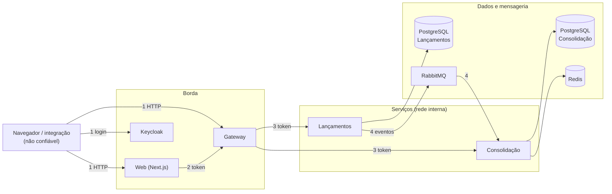

# 10 — Modelo de ameaças

Análise de ameaças do sistema com **STRIDE** por elemento e verificação contra o **OWASP API Security Top 10 (2023)**. Cada mitigação indica **onde** está no código ou na configuração e seu estado:

- ✅ **Implementado e verificado** (teste automatizado ou verificação no cluster)
- 🟡 **Parcial** (existe, com ressalva)
- ⬜ **Pendente** (risco conhecido, ainda sem mitigação)

O objetivo não é afirmar que o sistema é invulnerável, e sim mostrar o que foi pensado, o que está provado e o que ainda é risco aceito.

## 1. O que protegemos

| Ativo | Por que importa |
|---|---|
| **Lançamentos e saldos** | São o dinheiro do comerciante; adulterar ou ler o de outro é o pior cenário. |
| **Isolamento entre comerciantes** | Um comerciante nunca pode ver nem alterar dados de outro. |
| **Identidade e tokens** | Quem controla um token age como o comerciante. |
| **Disponibilidade do registro** | O comerciante precisa lançar mesmo com a Consolidação fora do ar (RNF-01). |
| **Segredos** | Senhas de banco, do broker e dos clientes OAuth. |
| **Texto livre da descrição** | Pode conter dado pessoal digitado pelo usuário (LGPD). |

## 2. Fronteiras de confiança

1. **Internet → borda:** tudo que entra é não confiável.
2. **Web → Gateway:** o servidor do Next.js chama a API em nome do usuário, com o token dele.
3. **Gateway → serviços:** o Gateway valida o token, mas **os serviços validam de novo**: a rede interna não é tratada como confiável.
4. **Serviços → dados e fila:** cada serviço tem seu próprio banco e usuário; a comunicação entre serviços é só por eventos.

## 3. STRIDE

### S — Falsificação de identidade (*Spoofing*)

| Ameaça | Mitigação | Estado |
|---|---|---|
| Chamar a API sem identidade ou com token forjado, expirado ou de outro emissor/público | JWT validado por **emissor, público, assinatura e validade** no Gateway e em cada serviço (`Authentication.cs`). Testes com tokens expirados, de público errado, de emissor errado e com assinatura forjada. | ✅ |
| Fazer-se passar por outro comerciante informando o identificador | O comerciante vem **só do *claim* `merchant_id` do token**; um cabeçalho `X-Merchant-Id` enviado pelo cliente é ignorado (teste dedicado). | ✅ |
| Roubo do código de autorização no login | *Authorization code* com **PKCE (S256)** e `state`; cliente público, sem segredo para vazar. | ✅ |
| Adivinhar senhas | Keycloak com proteção contra força bruta ligada. | 🟡 sem MFA; Keycloak em modo de desenvolvimento |
| Interceptar o token na rede | TLS na borda e entre serviços. | ⬜ localmente é HTTP; na nuvem exige TLS na borda e, depois, mTLS |

### T — Adulteração (*Tampering*)

| Ameaça | Mitigação | Estado |
|---|---|---|
| Alterar ou apagar um lançamento | **Não existe** rota de edição nem de exclusão: correção só por **estorno**, que cria um lançamento compensatório e só pode ocorrer uma vez (índice único no banco). | ✅ |
| Duplicar um lançamento (reenvio, clique duplo) | `Idempotency-Key` com resposta guardada na mesma transação; mesma chave com corpo diferente é recusada (422). | ✅ |
| Perder ou duplicar o evento entre o lançamento e o saldo | **Outbox** na mesma transação do lançamento; consumidor idempotente pelo identificador do evento; teste com 10 entregas simultâneas da mesma mensagem contando uma vez. | ✅ |
| Mensagem malformada ou de versão desconhecida na fila | Validação do contrato no consumidor; mensagem inválida vai para a **DLQ** com alerta, sem travar a fila. | ✅ |
| Saldo divergente por corrupção da projeção | O job de **reconciliação** detecta saldo alterado, evento perdido e evento sem lançamento ([13](13-reconciliacao.md)); o `event_log` permite **reconstruir** os saldos, e o reprocessamento exige o escopo administrativo. Verificado adulterando um saldo no cluster. | ✅ |
| Alguém com acesso ao banco altera dados diretamente | Privilégio mínimo e trilha imutável com selo de integridade. | ✅ [16](16-trilha-de-auditoria.md): cadeia de hashes por comerciante, log só de inserção, verificação a cada 10 min com alerta; 🟡 a ponta da cadeia não é ancorada fora do banco |
| Fila e *cache* sem autenticação forte | Credenciais por serviço e TLS no RabbitMQ e no Redis. | 🟡 RabbitMQ usa um usuário compartilhado com senha vinda de Secret; Redis sem senha, só dentro do cluster |

### R — Repúdio (*Repudiation*)

| Ameaça | Mitigação | Estado |
|---|---|---|
| "Eu não registrei esse lançamento" | Lançamentos são imutáveis e têm data de registro **e autor**; cada requisição tem **`correlation id`** e *trace*, e os logs (JSON) carregam o `TraceId`. | ✅ cada lançamento e estorno entra numa [cadeia de hashes](16-trilha-de-auditoria.md) com o autor |
| Não saber **quem** (usuário ou integração) registrou ou estornou | O lançamento **grava o autor** (`created_by` = `sub` do token) e o evento também (`createdBy`). O autor sai **sempre do token**, nunca do corpo da requisição (teste envia um `createdBy` falso e é ignorado); um estorno registra quem estornou, e o original mantém o seu autor. Token sem `sub` é recusado (403). Lançamentos anteriores à mudança ficam como `unknown`. | ✅ |
| Apagar rastros | Logs só em *stdout* e traces em memória (Jaeger local). | ⬜ na nuvem: retenção e armazenamento imutável de logs |

### I — Vazamento de informação (*Information disclosure*)

| Ameaça | Mitigação | Estado |
|---|---|---|
| Comerciante A lê dados do B (o risco nº 1 de uma API multi-inquilino) | **Toda consulta filtra por `merchantId`** do token (`EntryQueries`, `EntryRepository`, saldos); outro comerciante recebe **404**, sem revelar que o recurso existe. Testes cobrem leitura e estorno de lançamento alheio. | ✅ |
| Erro revelando detalhes internos (SQL, pilha, nomes de tabela) | Respostas de erro no padrão RFC 9457 com mensagens controladas; teste garante que um conflito de banco não vaza nome de restrição; *logging* sensível do EF desligado (parâmetros aparecem como `?`). | ✅ |
| Segredos no repositório | Varredura de segredos em todo o histórico (CI); senhas locais descartáveis e exigidas (`required`) no chart; nenhum segredo real versionado. | ✅ |
| Token acessível a *scripts* da página (XSS) | Token em cookie de sessão **criptografado e `HttpOnly`**; o navegador nunca chama a API; cabeçalhos `nosniff`, `X-Frame-Options: DENY`, CSP restritiva na API. | ✅ |
| Fingerprinting do servidor | Sem cabeçalho `Server` nem `X-Powered-By`. | ✅ |
| Dado pessoal no campo de descrição | Descrição é texto livre; não é enviada a métricas e o registro de comandos do banco não mostra valores (parâmetros mascarados), mas **não há política de retenção** nem aviso ao usuário. | 🟡 definir política LGPD (retenção, minimização, base legal) |
| Consoles de operação expostos | Grafana, Jaeger e Keycloak ficam acessíveis no *host* **só no ambiente local**, com senhas descartáveis. | 🟡 na nuvem ficam atrás de rede privada/VPN e SSO |

### D — Negação de serviço (*Denial of service*)

| Ameaça | Mitigação | Estado |
|---|---|---|
| Inundar a API | **Limite de taxa por comerciante** no Gateway (200 req/s, bem acima do pico legítimo de 50, pois 429 conta como perda); corpo máximo de 64 KB; limite de tempo por requisição (5 s). | ✅ medido no teste de estresse (150 req/s sem perda) |
| Consultas caras | Paginação com máximo de 200 itens; intervalo de saldo limitado a 366 dias. | ✅ |
| Mensagem "veneno" travando o consumo | DLQ para inválidas; reentrega com pausa para falhas transitórias; teste de integração. | ✅ |
| Falha da Consolidação derrubar o registro | **Isolamento por desenho** (Outbox + fila): lançamentos 100% aceitos com a Consolidação fora, medido sob carga. | ✅ |
| Perda de pod | Duas réplicas, `PodDisruptionBudget`, drenagem com `preStop`: 0 falhas ao perder um pod. | ✅ |
| Perda de nó, banco ou broker únicos | Réplicas e alta disponibilidade das dependências. | 🟡 camada 2 entregue ([14](14-alta-disponibilidade.md)): PostgreSQL e RabbitMQ replicados; perder o nó do banco primário recusa ~7,8% das escritas do teste durante o failover (~17 s); Keycloak ainda único |
| Ataque volumétrico de rede | WAF, proteção contra DDoS e *rate limit* por IP na borda da nuvem. | ⬜ |

### E — Elevação de privilégio (*Elevation of privilege*)

| Ameaça | Mitigação | Estado |
|---|---|---|
| Usar um token com escopo a mais do que o necessário | **Escopos mínimos por rota** (`entries:write`, `entries:read`, `balances:read`, `balances:rebuild`); clientes de integração só com o que precisam; o cliente de operação só reprocessa e **não lê saldos**. Verificado no cluster: 403 nos dois sentidos. | ✅ |
| Qualquer comerciante reprocessar saldos | Rota administrativa exige `balances:rebuild`, que só o cliente de operação tem. | ✅ |
| Escapar do contêiner | Usuário não-root, sistema de arquivos somente leitura, sem capacidades Linux, sem escalada de privilégio, perfil `seccomp` padrão. | ✅ |
| Um serviço lendo o banco do outro | Banco **por serviço**, com usuário próprio; a única ligação é o evento. | 🟡 as duas bases usam a mesma senha de Secret; na nuvem, credenciais separadas |
| Qualquer pod falando com qualquer pod | `NetworkPolicy` permitindo só Gateway → serviços e serviços → seus dados. | ✅ entrada fechada por padrão no namespace; cada caminho é aberto explicitamente ([17](17-isolamento-de-rede.md)); 🟡 a saída (egress) segue aberta |
| Papel de Auditor (leitura multi-comerciante) | Escopo e papel próprios, com restrição por atribuição. | ✅ [15](15-papel-de-auditor.md): somente leitura, só comerciantes atribuídos, cada acesso registrado; 🟡 a trilha é log, sem selo de integridade |
| Imagem adulterada | Proveniência e SBOM nas imagens publicadas; varredura de vulnerabilidades. | 🟡 sem assinatura de imagem nem política de admissão no cluster |

## 4. OWASP API Security Top 10 (2023)

| # | Risco | Como o sistema responde | Estado |
|---|---|---|---|
| API1 | Autorização quebrada em nível de objeto (BOLA) | Filtro por `merchantId` do token em toda consulta; 404 para recurso alheio; testes de leitura e estorno cruzados. | ✅ |
| API2 | Autenticação quebrada | JWT validado em duas camadas; PKCE; proteção contra força bruta. Sem MFA nem TLS local. | 🟡 |
| API3 | Autorização quebrada em nível de propriedade | Contratos de entrada explícitos (sem atribuição em massa): só tipo, valor, data e descrição são aceitos; `merchantId` nunca vem do corpo. | ✅ |
| API4 | Consumo irrestrito de recursos | Limite de taxa, tamanho de corpo, tempo limite, paginação e janela máxima de consulta. | ✅ |
| API5 | Autorização quebrada em nível de função | Escopo por rota; rota administrativa separada. | ✅ |
| API6 | Acesso irrestrito a fluxos de negócio sensíveis | Idempotência no registro; estorno único garantido por índice; sem edição nem exclusão. | ✅ |
| API7 | Falsificação de requisição do lado do servidor (SSRF) | A API **não** recebe URLs do usuário nem busca recursos externos. | ✅ não aplicável |
| API8 | Configuração incorreta de segurança | Cabeçalhos de segurança, erros padronizados, contêineres endurecidos, sem `Server`; varredura de configuração (Trivy) no CI. | ✅ |
| API9 | Gestão inadequada de inventário | Uma única versão (`/v1`), rotas do Gateway por **lista de permissão** (rota desconhecida dá 404 e não chega ao serviço); `/health` é a única rota anônima. | ✅ |
| API10 | Consumo inseguro de outras APIs | O consumidor trata a fila como entrada não confiável: valida contrato e versão e envia o inválido para a DLQ. | ✅ |

## 5. Riscos residuais, por prioridade

| # | Risco | Ação proposta |
|---|---|---|
| 1 | ~~Não se sabe quem registrou ou estornou~~ | **Resolvido**: autor em cada lançamento e cadeia de auditoria. Resta a consulta administrativa por autor. |
| 2 | Tráfego sem TLS dentro do cluster e na borda | TLS na borda (Ingress com certificado) e mTLS entre serviços (malha de serviço). |
| 3 | Credenciais compartilhadas; saída (egress) dos pods aberta | Usuários distintos por serviço no broker e nos bancos; segredos num gerenciador de segredos; `NetworkPolicy` de saída. |
| 4 | A ponta da cadeia de auditoria não é ancorada fora do banco | Publicar o hash da ponta em armazenamento só de escrita, de outro responsável, e conferi-lo ([16](16-trilha-de-auditoria.md#limitações)). |
| 5 | Auditor sem acesso temporário nem justificativa | Concessão com prazo e motivo. |
| 6 | Política de dados pessoais indefinida | Definir retenção e minimização da descrição; aviso ao usuário; mascaramento em logs. |
| 7 | Perder um nó ainda recusa requisições até o Kubernetes retirar o nó (~40 s no cluster local) e o Keycloak é único | Keycloak com banco externo e réplicas; balanceador com *health check* na nuvem. (O reenvio idempotente de escritas no Gateway já existe: [14](14-alta-disponibilidade.md).) |
| 8 | Imagens sem assinatura | Assinar com Sigstore (cosign) e exigir a assinatura no cluster (política de admissão). |

## 6. Ameaças específicas do Assistente de IA

O OWASP Top 10 para LLMs aplicado ao Assistente (injeção de instruções, saída não confiável, poder excessivo, vazamento, consumo ilimitado) está tratado, com as defesas e os testes, em [19 — Assistente de IA](19-assistente-de-ia.md#defesas-owasp-top-10-para-llms). A decisão central, do [ADR-0011](adr/0011-assistente-de-ia-por-interface.md), é que **a injeção não tem o que fazer**: o assistente não grava, não tem credencial de gravação, e o que devolve passa pela validação do domínio e pela confirmação da pessoa. Risco residual: a frase vai a um terceiro quando o provedor é o Claude (decisão de LGPD pendente).

## 7. Como manter este documento

Reavaliar a cada mudança de fronteira (novo serviço, nova integração, novo papel) e a cada incidente. As verificações automatizáveis já rodam no pipeline (CodeQL, varredura de segredos e de vulnerabilidades, ver [09](09-ci-cd.md)); as manuais ficam registradas aqui com seu estado.
