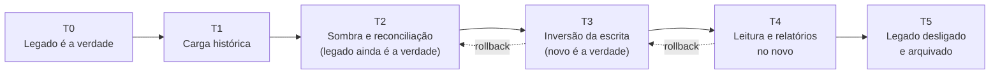

# 11 — Arquitetura de transição

Como chegar da situação de hoje à [arquitetura alvo](03-arquitetura-alvo.md) **sem parar o comerciante e sem apostar tudo num dia só**. Este documento trata de duas transições:

- **A. Do sistema atual (legado) para o novo.** Migração de dados e de uso.
- **B. Da plataforma de entrega para a de nuvem.** Como o próprio sistema evolui (camada 1 → camada 2 → nuvem).

## Premissa sobre o legado (a confirmar)

O enunciado **não descreve** o sistema atual. Assumimos o cenário mais comum: o comerciante controla o fluxo de caixa em **planilhas ou em um sistema único (monolítico)**, com um banco relacional ou arquivos, sem eventos e com o saldo calculado na hora, por consulta ou fórmula. Se o legado real for diferente (por exemplo, um ERP), as fases abaixo continuam valendo; mudam apenas o mecanismo de captura de dados e a lista de campos mapeados. **Esta premissa precisa de validação com o negócio antes de fixar prazos.**

## Princípios

1. **Nunca *big bang*.** Cada fase é reversível e tem critério objetivo de entrada e de saída.
2. **Estrangulamento progressivo (*strangler fig*).** O novo sistema assume uma capacidade por vez, enquanto o legado encolhe até poder ser desligado.
3. **Verdade única em cada momento.** Em cada fase há **uma** fonte da verdade declarada; a outra é cópia a ser reconciliada.
4. **Primeiro leitura, depois escrita.** Começar pelo que não pode causar dano (importar e comparar) antes de aceitar lançamentos de verdade.
5. **Medir antes de avançar.** Só se passa de fase com divergência de saldo igual a zero durante um período combinado.

## A. Do legado para o novo sistema

| Fase | O que acontece | Fonte da verdade | Critério para avançar | Como voltar atrás |
|---|---|---|---|---|
| **T0** | Legado em uso; novo sistema instalado, sem dados. | Legado | Novo ambiente no ar e testado (já existe: [05](05-execucao-local.md)). | n/a |
| **T1: Carga histórica** | Importa o histórico do legado para o novo sistema. | Legado | Saldo diário do novo **igual** ao do legado em todo o período importado. | Apagar o ambiente e refazer (nada em produção depende dele). |
| **T2: Sombra** | Cada lançamento novo é copiado do legado para o novo (captura de mudanças ou importação frequente). Ninguém usa o novo ainda. A **reconciliação diária** compara os saldos. | Legado | Divergência **zero por N dias seguidos** (sugestão: 15 dias, incluindo um fechamento de mês). | Parar a cópia; o legado nunca deixou de ser a verdade. |
| **T3: Inversão da escrita** | Os comerciantes passam a lançar no novo sistema, **um grupo piloto por vez**. O legado recebe uma cópia reversa por algumas semanas. | **Novo** | Piloto sem incidentes por N dias; depois, ondas maiores até 100%. | Voltar o grupo ao legado: ele ainda tem a cópia reversa, então não perdeu nada. |
| **T4: Leitura e relatórios** | Relatórios, painéis e integrações passam a ler o saldo consolidado do novo sistema. Legado fica somente leitura. | Novo | Nenhum consumidor do legado restante; auditoria satisfeita. | Reativar a leitura do legado (ele continua íntegro). |
| **T5: Desligamento** | Legado arquivado (cópia imutável e acessível para consulta e obrigações legais). | Novo | Prazo de retenção definido e cópia verificada. | Restaurar do arquivo, se necessário. |

A cópia reversa em T3 é o que torna a inversão **segura**: o legado fica sempre atualizado, então voltar atrás é uma troca de chave, não uma recuperação de desastre.

### Como o novo sistema já suporta isso

Várias capacidades já existem e foram pensadas para a transição:

| Necessidade | Como o sistema atende |
|---|---|
| Importar histórico sem duplicar, mesmo repetindo a carga | A API de lançamentos é **idempotente**: usar como `Idempotency-Key` o identificador do lançamento no legado (por exemplo `legacy-12345`) faz com que reexecutar a carga inteira não duplique nada. |
| Datas do passado | **Lançamentos retroativos são aceitos** e corrigem os saldos dos dias seguintes. |
| Correção de erros na carga | **Estorno** (e novo lançamento), nunca edição; mantém o rastro. |
| Reconstruir o saldo se a carga tiver problema | **Reprocessamento** do saldo a partir do histórico de eventos ([ADR-0010](adr/0010-reprocessamento-por-registro-de-eventos.md)). |
| Importar em volume sem derrubar o sistema | Testado a 150 req/s sem perda ([07](07-testes-de-carga-e-resiliencia.md)); a carga pode rodar em lotes controlados pelo limite de taxa do Gateway. |

### Mapeamento de dados

| Legado (a confirmar) | Novo sistema | Regra |
|---|---|---|
| Valor positivo / entrada | Lançamento **Crédito** | Valor sempre positivo, até duas casas decimais. |
| Valor negativo / saída | Lançamento **Débito** | Gravar o valor absoluto. |
| Data do movimento | `entryDate` | Interpretada no **fuso do comerciante** (São Paulo); atenção a registros com horário perto da meia-noite. |
| Histórico / observação | `description` | Até 200 caracteres; truncar com registro do que foi cortado. |
| Identificador do legado | `Idempotency-Key` (`legacy-<id>`) | Chave estável: garante carga repetível. |
| Quem lançou no legado | Autor do lançamento (`createdBy`) | O autor vem do token da conta de carga, então o histórico migrado aparece como lançado por ela; o autor original do legado vai na descrição (ou fica no arquivo do legado). |
| **Saldo inicial** | Um crédito na **data de corte** (descrição "Saldo inicial migrado") | O sistema parte de **saldo zero** (premissa P4), então o saldo que o legado já tinha na data de corte entra como um lançamento explícito. |
| Estornos / cancelamentos do legado | Lançamento e estorno correspondentes | Preservar o par, não "somar e esquecer". |
| Comerciante | `merchant_id` do cliente no Keycloak | Mapa legado → identidade criado e revisado antes da carga. |

### Reconciliação: o instrumento da transição

A transição só é segura se **comparar automaticamente** os dois lados. O que é preciso:

- **Comparação diária** do saldo por comerciante e por dia: legado × consolidado, com tolerância **zero**.
- **Relatório de divergências** (qual dia, qual comerciante, quanto, e quais lançamentos explicam a diferença).
- **Alerta** quando houver divergência.

O job de reconciliação do RNF-07 **já existe** ([13](13-reconciliacao.md)) e confere o novo sistema contra si mesmo (lançamentos × eventos × saldos). Para a fase de sombra falta a **segunda metade**: comparar o saldo do **legado** com o consolidado, que depende de um adaptador de leitura do legado (a definir quando ele for conhecido). O mesmo relatório e os mesmos alertas servem.

## B. Da plataforma de hoje para a nuvem (camadas)

A entrega foi desenhada em camadas ([ADR-0008](adr/0008-helm-e-kind.md)); este é o caminho entre elas:

| Etapa | Estado | O que muda | Como migrar sem parada |
|---|---|---|---|
| **Hoje: camada 1** | Serviços, Gateway e web com 2 réplicas; dependências em instância única; kind local. | n/a | n/a |
| **Camada 2** | PostgreSQL com réplica, RabbitMQ em 3 nós, Redis com réplica. | Dependências passam a tolerar a perda de um nó (o ponto fraco medido em [07](07-testes-de-carga-e-resiliencia.md)). | **PostgreSQL:** criar o cluster novo, replicar, e trocar o endereço com os serviços reiniciando em *rolling update*. **RabbitMQ:** filas clássicas não viram *quorum queues* no lugar; cria-se a fila nova, liga-se um segundo *binding* ao exchange, drena-se a antiga e remove-se. Como o consumo é idempotente, qualquer mensagem entregue duas vezes nesse intervalo não altera o saldo. |
| **Nuvem** | Mesmo chart, valores de nuvem. | Imagens do GHCR (já publicadas pela release), Keycloak com banco externo e TLS, segredos num gerenciador, observabilidade com armazenamento durável. | Ambiente novo em paralelo (*blue/green*), validado com o *smoke test* e o teste de carga, e troca de DNS gradual. |

### Evolução sem quebrar quem já está rodando

- **Contrato de eventos versionado** (`schemaVersion`): o consumidor rejeita versões desconhecidas para a DLQ em vez de interpretar errado, então produtor e consumidor podem ser atualizados em momentos diferentes. Mudanças compatíveis acrescentam campos; quebras viram uma nova versão aceita pelos dois lados durante a janela de troca.
- **Migrações de banco em duas etapas (*expand/contract*):** primeiro adicionar (compatível com a versão antiga), depois trocar o código, por fim remover. As migrações rodam na partida do serviço com trava, e o *rolling update* mantém sempre uma versão antiga atendendo.
- **Versão da API na rota** (`/v1`): uma `/v2` convive com a `/v1` até os clientes migrarem.

## Riscos da transição e mitigação

| Risco | Mitigação |
|---|---|
| Divergência de regra de negócio entre legado e novo (arredondamento, fuso, estorno) | Fase de sombra com reconciliação diária **antes** de qualquer usuário depender do novo; casos de borda levantados com o negócio. |
| Dados sujos no legado (duplicados, datas inválidas, valores zero) | Relatório de qualidade na carga histórica; rejeitados vão para uma fila de tratamento manual, nunca descartados em silêncio. |
| Resistência ou erro operacional dos comerciantes | Piloto com poucos comerciantes; treinamento; legado com cópia reversa para voltar atrás. |
| Carga de migração afetando o ambiente | Importação em lotes, dentro do limite de taxa, em horários de baixo uso; monitorada no painel de [06](06-observabilidade.md). |
| Perda de dado na virada | Cópia reversa por algumas semanas; legado arquivado de forma imutável antes do desligamento. |
| Dependência de uma pessoa ou de conhecimento tácito do legado | Documentar o mapeamento e as regras do legado como parte da carga; revisão com quem o opera hoje. |

## Critérios de sucesso

- **Divergência de saldo igual a zero** entre legado e novo durante toda a fase de sombra.
- Nenhum lançamento perdido ou duplicado (verificável pela chave de idempotência e pela reconciliação).
- **Nenhum período de indisponibilidade** do registro de lançamentos durante a transição.
- Inversão da escrita concluída com todos os comerciantes, sem uso do *rollback*, e legado desligado com a cópia arquivada verificada.

## O que depende de decisão do negócio

1. Descrição real do sistema atual (para fixar o mecanismo de captura e o mapeamento).
2. Duração da fase de sombra e o tamanho do grupo piloto.
3. Prazo de retenção do arquivo do legado (obrigações legais e fiscais).
4. Quem assume a decisão de avançar ou voltar em cada fase.
