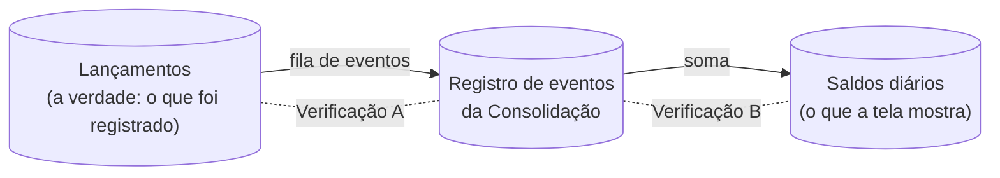

# 13 — Reconciliação (RNF-07)

Cumpre o RNF-07: **"o saldo nunca diverge da soma dos lançamentos; um job de reconciliação verifica isso periodicamente"**. O sistema é feito de duas partes ligadas por uma fila; a reconciliação é a conferência que prova, de tempos em tempos, que nada se perdeu no meio do caminho.

## O que ela confere

O saldo passa por três "lugares" até chegar à tela. A reconciliação compara os vizinhos:

| Verificação | Compara | Se divergir, a causa provável é | Como corrigir |
|---|---|---|---|
| **A: Lançamentos × eventos** | Totais por comerciante e dia no serviço de Lançamentos × o que o registro de eventos da Consolidação somou | Um evento **se perdeu, está atrasado ou sobrou** | Investigar a fila, a DLQ e o Outbox; reenviar o evento. O reprocessamento **não** resolve, porque o evento nem chegou. |
| **B: eventos × saldos** | O que o registro de eventos soma × o saldo diário guardado | O saldo foi **corrompido ou alterado** fora do fluxo normal | **Reprocessar** o saldo a partir do registro de eventos (`POST /v1/balances/rebuild`). |

Separar as duas importa: elas apontam para causas e remédios diferentes.

## Como funciona

- **Quem roda:** a Consolidação, a cada **10 minutos**, sobre os **últimos 3 dias** contábeis. Com duas réplicas, uma trava do PostgreSQL (*advisory lock*) garante que **só uma execute por vez**, então o serviço de Lançamentos é consultado uma vez por intervalo, não uma por réplica.
- **De onde vêm os totais de Lançamentos:** do endpoint interno `GET /v1/reconciliation/daily-totals`, que lê **todos** os comerciantes. Por isso exige um escopo próprio (`entries:reconcile`), que **só** o cliente do job possui (`reconciler`, *client credentials*), e **o Gateway não o roteia**: é alcançável apenas de dentro do cluster (há teste: com um token de todos os escopos, o Gateway responde 404 e nada chega ao serviço).
- **Tolerância ao atraso natural:** a comparação A só considera lançamentos **mais velhos que 2 minutos** (`graceSeconds`). Sem isso, um evento ainda a caminho na fila seria um falso alarme. A comparação B não precisa dessa folga: o consumidor grava o evento e atualiza o saldo na **mesma transação**, e a consulta lê os dois num único instante consistente.
- **Sob demanda:** `POST /v1/balances/reconcile` (escopo administrativo) roda agora e devolve o relatório, com no máximo 200 divergências detalhadas. Útil depois de um incidente e na fase de sombra da [transição](11-arquitetura-de-transicao.md).
- **O que ela não faz:** **não corrige sozinha.** Detecta e avisa. Corrigir saldo automaticamente poderia esconder um defeito que precisa de uma pessoa; a correção (reprocessar) é uma decisão operacional.

## Observabilidade

| Sinal | Significado |
|---|---|
| `cashflow.reconciliation.runs{result}` | Execuções: `consistent`, `diverged` ou `failed` |
| `cashflow.reconciliation.divergences{kind}` | Comerciantes-dia que divergem na última execução (`entries_vs_events`, `events_vs_balances`) |
| `cashflow.reconciliation.last_run_unixtime` | Quando a última execução terminou |

Alertas ([06](06-observabilidade.md)): **`ReconciliationDivergence`** (crítico: qualquer divergência por mais de 10 minutos) e **`ReconciliationStopped`** (aviso: nenhuma execução concluída há mais de 30 minutos, ou seja, o próprio job parou). O painel do Grafana tem uma linha dedicada.

## Provas

**Testes automatizados** (7 de integração com PostgreSQL real, 9 da lógica de comparação, 3 do cliente HTTP, 6 do endpoint de Lançamentos e 1 do Gateway): sistema íntegro não diverge; **evento que nunca chegou** é achado; **saldo adulterado** é achado e o reprocessamento o cura; **saldo sem nenhum evento por trás** é achado; **evento de um lançamento que não existe** é achado; lançamentos mais novos que a folga não são comparados; o endpoint só responde ao escopo administrativo; o cliente HTTP obtém o token, o reaproveita até pouco antes de expirar e trata resposta de erro como erro (uma lista vazia seria lida como "não há lançamentos" e faria todos os saldos parecerem errados).

**No cluster real**, sobre os dados acumulados:

1. Sistema são: `consistent = true`, 0 divergências.
2. Alterei um saldo direto no banco (+5 de crédito): o job apontou `EventsVsBalances`, esperado 1.265,64 e encontrado 1.270,64.
3. Reprocessei esse dia: `consistent = true` de novo.

## Uma falha real que isto ajudou a achar

Ao escrever os testes, aparecia uma falha intermitente: às vezes o saldo nunca recebia o lançamento. A causa era uma **corrida de inicialização**: o serviço de Lançamentos declarava só a *exchange* no RabbitMQ; a **fila** era declarada pela Consolidação ao iniciar. Um evento publicado **antes da primeira partida da Consolidação** (partida a frio, ou o RabbitMQ perdendo seus dados) caía numa *exchange* sem fila ligada, e o RabbitMQ **descarta a mensagem em silêncio**. O lançamento ficava gravado, mas o saldo nunca o recebia. É exatamente a classe de defeito que a reconciliação existe para detectar.

**Correção:** o publicador agora também declara a fila do consumidor (mesmos nomes e argumentos, de forma idempotente), então o evento espera na fila mesmo que a Consolidação nunca tenha rodado. Testes novos cobrem: o evento publicado antes do consumidor **não se perde** (e o teste **falha** sem a correção, verificado); publicador e consumidor declaram a mesma topologia em qualquer ordem; os nomes dos dois lados são iguais.

## Limitações

- **Janela de 3 dias** por padrão: uma divergência mais antiga passa despercebida. Vale uma varredura completa periódica (por exemplo, semanal) como evolução; o limite por execução é de 31 dias.
- **Lançamento apagado ou alterado direto no banco de Lançamentos:** a reconciliação confia nesse banco como verdade. Quem cobre esse caso é a [trilha de auditoria](16-trilha-de-auditoria.md), que encontra lançamento editado, apagado ou inserido fora do serviço.
- **Atraso maior que a folga** (fila com *backlog* de mais de 2 minutos) pode gerar divergência temporária do tipo A; ela some quando a fila drena, e por isso o alerta só dispara depois de 10 minutos.
- **Primeira execução após uma troca de versão** pode falhar com 401 se o Keycloak ainda estiver reimportando o *realm*; ela se recupera na execução seguinte. Foi visto uma vez no cluster local.
- A reconciliação cobre **valores por comerciante e dia**, não a quantidade de lançamentos nem seus atributos (descrição, autor).
