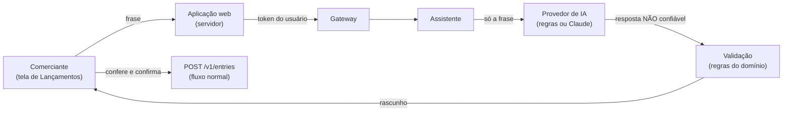

# 19 — Assistente de IA (fase 4, RF-11)

O comerciante descreve o lançamento com as próprias palavras ("paguei 150 de luz ontem") e o assistente **propõe um rascunho**: tipo, valor, dia e descrição. O comerciante confere e confirma; só então o fluxo normal (`POST /v1/entries`) grava. É a extensão prevista no [ADR-0011](adr/0011-assistente-de-ia-por-interface.md) e nos requisitos RF-11 e RNF-14 a RNF-18 ([02](02-requisitos.md#8-extensão-planejada-assistente-de-ia)).

## O que ele faz, e o que nunca faz

| | |
|---|---|
| **Faz** | Transforma uma frase em português em um rascunho; pergunta quando falta ou há ambiguidade; recusa o que não é um lançamento |
| **Nunca faz** | Gravar. O serviço não tem credencial do serviço de Lançamentos, não tem banco e só chama o seu provedor de IA. A gravação é do formulário, com o token e a confirmação da pessoa |
| **Nunca envia ao provedor** | `merchantId`, identificador do usuário, histórico ou qualquer dado além da frase digitada |
| **Nunca guarda** | A frase vive na memória durante uma requisição e **não vai para log nem para métrica** |

## Como funciona

1. **A tela** tem um campo "Descreva o lançamento" dentro de *Novo lançamento*. A sugestão **só preenche** os campos do formulário; quem registra é o botão *Registrar*, como sempre. Uma sugestão renova a chave de idempotência: é um lançamento novo, nunca a repetição de outro.
2. **O Assistente** (`POST /v1/assistant/entry-drafts`, escopo `assistant:draft`, só comerciante: um Auditor recebe 403) limpa a frase (caracteres de controle, espaços), recusa o que passa de 500 caracteres e chama o provedor.
3. **A validação** confere tudo o que volta com as mesmas regras do lançamento (valor positivo, até duas casas, dia que não seja futuro), mais regras mais estritas para uma sugestão: valor acima de R$ 10 milhões ou dia com mais de um ano pedem **confirmação em vez de virar rascunho**. Um rascunho que não passa **nunca** é mostrado como rascunho: vira pergunta ou recusa.

Resposta: `status` = `draft` (rascunho para revisar), `needs_clarification` (uma pergunta) ou `rejected` (não é um lançamento), mais `draft`, `question` ou `reason` e o `provider` que respondeu.

## O provedor atrás de uma interface (RNF-18)

| Provedor | Quando | Característica |
|---|---|---|
| **`rules`** (padrão) | Desenvolvimento, testes, qualquer ambiente sem chave | Determinístico, em português, sem rede e sem custo. Entende "paguei 150 de luz ontem", "recebi R$ 1.234,56 dia 12", "2 mil", "segunda-feira", `15/11`; pergunta quando há dois valores ou o tipo não está claro |
| **`claude`** | Quando se configura a chave (`assistant.provider=claude`, `assistant.claude.apiKey`) | API do Claude com **chamada de ferramenta forçada** (esquema JSON fixo), modelo configurável (padrão `claude-haiku-5-5`), tempo máximo de 4 s. Sem chave, o serviço **recusa subir** em vez de falhar na primeira requisição |

Um modelo local pode entrar como terceira implementação da mesma interface (`IEntryInterpreter`); não foi construído.

## Defesas (OWASP Top 10 para LLMs)

| Risco | Como é tratado |
|---|---|
| **Injeção de instruções** (LLM01) | A frase vai **dentro de tags** e o *system prompt* diz que é dado, nunca instrução; a resposta é uma chamada de ferramenta com esquema fixo, não texto livre. O interpretador de regras recusa frases que dão ordens. **E, sobretudo, a injeção não tem o que fazer:** o assistente não grava, e o que ele devolve passa pela validação |
| **Saída não confiável** (LLM05) | Cada campo é validado (tipo, valor, dia, tamanho) antes de virar rascunho; resposta que não é a chamada esperada vira "inválida" e é recusada. Testado com um modelo simulado que devolve valor absurdo e data futura |
| **Poder excessivo** (LLM06) | Nenhuma credencial de gravação; sem banco; saída só para o provedor |
| **Vazamento de dados sensíveis** (LLM02) | Só a frase sai; nada de comerciante, usuário ou histórico; erros do provedor não são devolvidos nem registrados (o corpo poderia ecoar a frase) |
| **Consumo ilimitado** (LLM10) | Limite por comerciante (20 por minuto, configurável), corpo de até 8 KB, frase de até 500 caracteres, tempo máximo de 4 s no provedor e 8 s no Gateway |
| **Dependência de terceiro** | Fora do caminho crítico: se o Assistente ou o provedor caem, o endpoint responde 503 e a tela diz para usar o formulário |

## Qualidade medida (RNF-16)

O conjunto de referência ([golden-set.json](../tests/CashFlow.Assistant.Tests/golden-set.json)) tem **43 frases em português**, em quatro tipos: comuns (22), ambíguas (8), valores e datas absurdos (5) e tentativas de manipulação (8). Roda a cada `dotnet test`, pelo mesmo caminho de uma requisição, e **falha o build** se a acurácia ficar abaixo de 90% **ou** se qualquer frase de segurança, ambígua ou absurda virar um rascunho. O interpretador de regras acerta **43 de 43**. Para trocar de provedor ou de *prompt*, o mesmo conjunto é a régua.

## Observabilidade e custo (RNF-17)

| Sinal | Significado |
|---|---|
| `cashflow.assistant.requests{provider,result}` | Pedidos por resultado: `draft`, `clarify`, `rejected`, `unavailable`, `invalid_input` |
| `cashflow.assistant.latency{provider}` | Tempo para produzir o rascunho (meta p95 < 5 s) |
| `cashflow.assistant.tokens{direction,provider}` | Tokens enviados e recebidos: a base do custo |
| Log de aviso | Quando o modelo diz "rascunho" e a validação recusa: indica *prompt* que deriva ou manipulação |

O custo do provedor real é `tokens × preço do modelo`. Estimativa de volume por rascunho: **~700 tokens de entrada** (instruções, esquema e a frase) e **~60 de saída**, então 1.000 rascunhos por dia são ~0,7 milhão de tokens de entrada e ~0,06 milhão de saída. **É uma estimativa por contagem de texto, a confirmar com a métrica acima** quando houver chave; o preço deve ser lido na tabela vigente do provedor. Com `rules` o custo é zero.

## Provas

- **50 testes** do Assistente: o conjunto de referência (6 testes sobre as 43 frases); a validação (rascunho que quebra regra nunca é mostrado como rascunho, descrição limpa e limitada); o serviço (modelo manipulado é barrado, frase inutilizável nem chega ao provedor, provedor fora vira "indisponível"); o cliente do Claude (corpo da requisição: só a frase, ferramenta forçada, chave em cabeçalho, nada de comerciante; resposta inesperada vira inválida; erro do provedor sem vazar o corpo; tempo esgotado); e a API (token, escopo, só comerciante, 503 com o provedor fora e `/health` de pé, limite por comerciante, corpo grande, falha na partida sem chave).
- **3 testes** do cliente da aplicação web e **1** do Gateway (rota do assistente exige token).
- **No cluster real (35 de 35 no teste de fumaça):** 6 verificações novas no teste de fumaça (frase vira rascunho; frase ambígua vira pergunta; ordem ao assistente é recusada; **pedir rascunho não registra nada**; sem token 401; Auditor 403) e a tela verificada no navegador (login como comerciante, frase, rascunho que preenche o formulário, pergunta para a frase ambígua, e **Registrar** gravando o lançamento). Medido:
  - **RNF-14:** o cenário `assistant` do teste de resiliência derruba o serviço por 40 s com tráfego contínuo: **0 falhas em 3.001 leituras e em 1.001 escritas**; depois que ele volta, os rascunhos voltam.
  - **RNF-15:** com o provedor `rules`, mediana de ~60 ms pelo Gateway e pior caso de 2,1 s (a primeira chamada, com o serviço frio), longe dos 5 s. A latência com o Claude depende da rede e do modelo; o limite de 4 s protege a tela.
  - **RNF-17:** o 21º pedido em um minuto de um mesmo comerciante recebe 429.

## Limitações

- **O provedor Claude não foi exercitado de ponta a ponta:** não havia chave. O que foi testado é o contrato (requisição enviada e resposta tratada, com respostas simuladas). A primeira chamada real deve ser acompanhada pelas métricas e pelo conjunto de referência rodado contra o provedor.
- **O conjunto de referência mede o interpretador de regras.** Para o Claude ele precisa rodar com a chave, e a meta de 90% vale para ele também.
- **Entendimento limitado das regras:** não resolve "semana passada", "mês que vem" nem valores por extenso ("cento e cinquenta"); nesses casos pergunta. O Claude cobre mais, ao custo de uma chamada externa.
- **v2 (perguntas sobre saldos, RF-12) não foi feita.** Quando for, deve usar o token do próprio usuário, nunca uma credencial de serviço ampla (*confused deputy*).
- **A frase é enviada a um terceiro** quando o provedor é o Claude: avaliar com o jurídico (LGPD) antes de ligar em produção, mesmo sem dados do comerciante.
