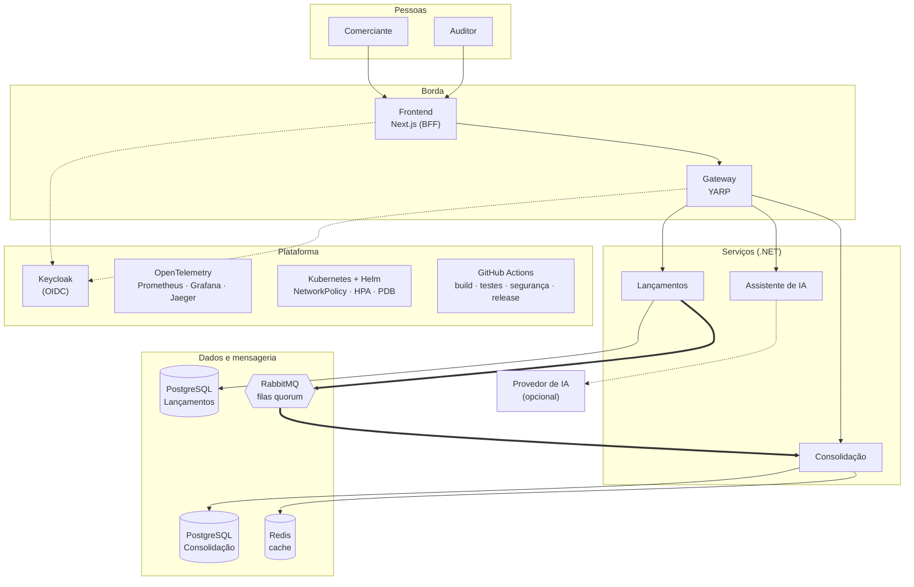
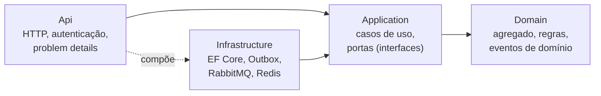
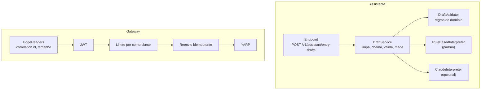
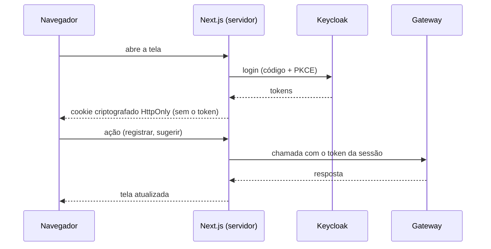
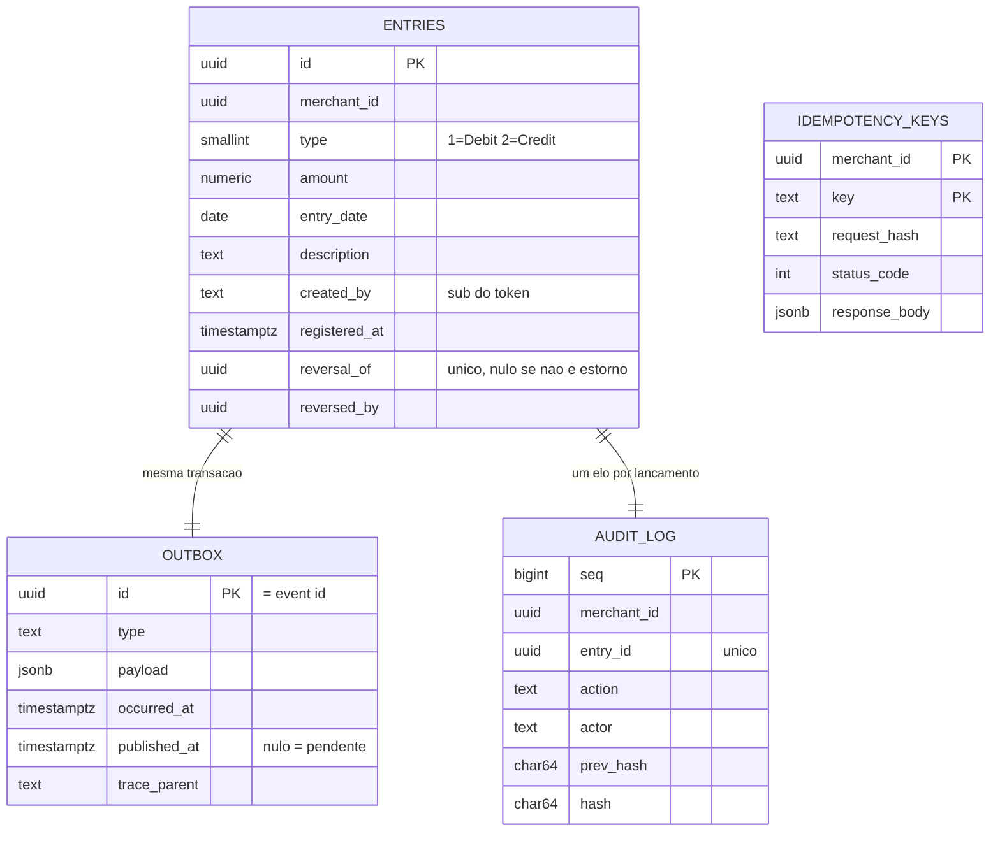
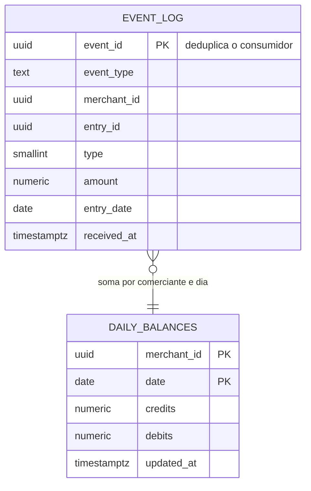
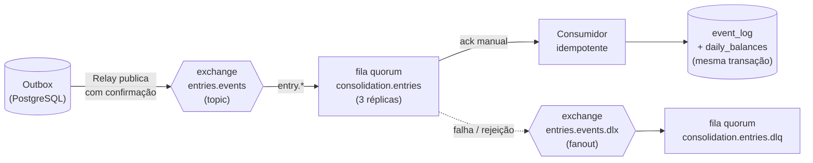

# 20 — Arquitetura por área

Um mapa para achar a arquitetura de cada parte do sistema, com os diagramas que faltavam para cada uma. Cada área aponta para a **decisão** (ADR), para o **desenho** e para a **evidência**.

## Mapa geral

## Existe arquitetura em cada parte? (resposta direta)

| Área | Decisão (ADR) | Desenho | Evidência | Estado |
|---|---|---|---|---|
| **C4 (sistema, contêineres, componentes, implantação)** | [0001](adr/0001-servicos-orientados-a-eventos.md) | [C4](architecture/c4.md): contexto, contêineres, componentes de Lançamentos e de Consolidação, implantação | Diagramas versionados | ✅ Falta o componente do Assistente e do Gateway (abaixo) |
| **Sistema (estilo, fluxos, falhas)** | [0001](adr/0001-servicos-orientados-a-eventos.md), [0003](adr/0003-padrao-outbox.md), [0010](adr/0010-reprocessamento-por-registro-de-eventos.md), [0021](adr/0021-idempotencia-por-chave-na-requisicao.md) | [03](03-arquitetura-alvo.md) | Testes de integração e medições ([07](07-testes-de-carga-e-resiliencia.md)) | ✅ |
| **Backend** | [0012](adr/0012-backend-dotnet.md) | [Camadas](#backend-camadas-de-cada-serviço) abaixo e C4 nível 3 | 254 testes | ✅ |
| **Frontend** | [0013](adr/0013-frontend-nextjs-bff.md) | [08](08-frontend.md) e [fluxo do BFF](#frontend-o-servidor-chama-a-api) abaixo | 45 testes e verificação no navegador | ✅ |
| **Banco de dados** | [0004](adr/0004-postgresql-por-servico.md), [0016](adr/0016-alta-disponibilidade-postgresql-e-broker.md), [0017](adr/0017-trilha-de-auditoria-encadeada.md) | [Modelo de dados](#banco-de-dados-modelo-de-dados) abaixo | Migrações versionadas; testes com PostgreSQL real | ✅ |
| **Mensageria (RabbitMQ)** | [0002](adr/0002-rabbitmq-como-broker.md), [0003](adr/0003-padrao-outbox.md), [0016](adr/0016-alta-disponibilidade-postgresql-e-broker.md) | [Topologia](#mensageria-topologia-do-rabbitmq) abaixo e contrato do evento em [03](03-arquitetura-alvo.md) | Testes de topologia; perda de nó | ✅ |
| **Cache (Redis)** | [0005](adr/0005-redis-cache-de-leitura.md) | [03](03-arquitetura-alvo.md) (fluxo de leitura) | Teste de Redis fora do ar; 93% das leituras no cache | ✅ |
| **Segurança** | [0006](adr/0006-keycloak-oidc.md), [0007](adr/0007-yarp-gateway.md), [0018](adr/0018-papel-de-auditor-por-atribuicao.md), [0019](adr/0019-isolamento-de-rede.md) | [10](10-modelo-de-ameacas.md), [15](15-papel-de-auditor.md), [16](16-trilha-de-auditoria.md), [17](17-isolamento-de-rede.md) | STRIDE, OWASP, testes, pod intruso bloqueado | ✅ |
| **IA** | [0011](adr/0011-assistente-de-ia-por-interface.md) | [19](19-assistente-de-ia.md) (fluxo e defesas) | 50 testes, conjunto de referência de 43 frases | ✅ Provedor real sem chave de teste |
| **DevOps (CI/CD)** | [0014](adr/0014-ci-cd-github-actions.md) | [09](09-ci-cd.md) (diagrama do pipeline) | Pipelines passando no GitHub (23/11) | ✅ Passa no GitHub, CodeQL incluído; ✅ 0 alertas abertos no code scanning |
| **Infra (plataforma local e HA)** | [0008](adr/0008-helm-e-kind.md), [0016](adr/0016-alta-disponibilidade-postgresql-e-broker.md), [0019](adr/0019-isolamento-de-rede.md) | [05](05-execucao-local.md), [14](14-alta-disponibilidade.md), [C4 implantação](architecture/c4.md) | Perda de pod, banco e nó medidos | ✅ |
| **Infra em nuvem** | [0015](adr/0015-nuvem-kubernetes-portatil.md) | [21](21-nuvem.md) e [custos](12-estimativa-de-custos.md) | Chart renderizado em modo nuvem | 🟡 **Nunca implantado; sem Terraform** |
| **Observabilidade** | [0009](adr/0009-observabilidade-opentelemetry.md) | [06](06-observabilidade.md) | Painel, alertas, *trace* de ponta a ponta | ✅ |
| **Transição do legado** | (premissa explícita) | [11](11-arquitetura-de-transicao.md) | — | ✅ Desenho; o legado é uma suposição |

## Backend: camadas de cada serviço

Cada serviço .NET tem as mesmas camadas, com a dependência apontando para dentro (o domínio não conhece banco, fila nem HTTP):

| Serviço | Projetos | Responsabilidade |
|---|---|---|
| **Lançamentos** | `Entries.Domain`, `.Application`, `.Infrastructure`, `.Api` | Registrar e estornar (imutável), idempotência, Outbox, cadeia de auditoria, totais para a reconciliação |
| **Consolidação** | `Consolidation.Application`, `.Infrastructure`, `.Api` | Consumir eventos (idempotente), projetar o saldo, cache, reprocessar, reconciliar |
| **Assistente** | `Assistant.Core`, `.Api` | Frase → rascunho validado (sem banco, sem gravação) |
| **Gateway** | `Gateway` | Validar token, limite por comerciante, reenvio idempotente, cabeçalhos de segurança |
| **Compartilhados** | `Observability`, `Security` | Telemetria e a regra de quem lê o quê (comerciante/Auditor) |

### Componentes do Assistente e do Gateway (C4 nível 3)

## Frontend: o servidor chama a API

O token **nunca chega ao navegador** ([ADR-0013](adr/0013-frontend-nextjs-bff.md)).

## Banco de dados: modelo de dados

Dois bancos, um por serviço; a única ligação entre eles é o evento.

Decisões que aparecem no modelo: **estorno em vez de edição** (um lançamento nunca muda, só ganha `reversed_by`); **`reversal_of` único** (um lançamento só se estorna uma vez, até em concorrência); **Outbox na mesma transação** (nunca perde evento); **`event_log` com chave primária** (a entrega repetida é descartada); **`audit_log` só de inserção** com encadeamento de hashes; o saldo é **derivado** e pode ser reconstruído do `event_log`.

## Mensageria: topologia do RabbitMQ

- **Chaves de roteamento:** `entry.registered` e `entry.reversed`.
- **Garantias:** mensagem persistente, confirmação do publicador, *ack* manual, entrega **pelo menos uma vez** com consumidor **idempotente** (o resultado é exatamente uma vez).
- **Quem declara a fila:** o publicador **e** o consumidor, com os mesmos argumentos (um teste garante); isso evita perder evento publicado antes da primeira partida do consumidor.
- **DLQ:** mensagem com falha vai para a fila de erros, que tem métrica e alerta.

## DevOps e infraestrutura em uma página

| Camada | O que há | Onde |
|---|---|---|
| **Código → imagem** | Dockerfiles, imagens não-root | `deploy/docker` |
| **Pipeline** | Build, testes, cobertura, CodeQL, gitleaks, Trivy, kubeconform, e2e em kind, release com proveniência e SBOM | [09](09-ci-cd.md) |
| **Entrega** | Um chart Helm (serviços, dependências, observabilidade, política de rede, Ingress) e um script (`up.ps1`) | `deploy/helm/cashflow`, `scripts/` |
| **Ambiente local** | kind com 4 nós, PostgreSQL com réplica, RabbitMQ em 3 nós | [05](05-execucao-local.md), [14](14-alta-disponibilidade.md) |
| **Nuvem** | Mesmo chart, `values` por provedor | [21](21-nuvem.md) |
| **Operação** | Painel, alertas, reconciliação e verificação da cadeia de auditoria | [06](06-observabilidade.md), [13](13-reconciliacao.md), [16](16-trilha-de-auditoria.md) |
