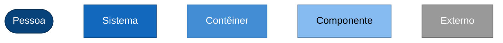
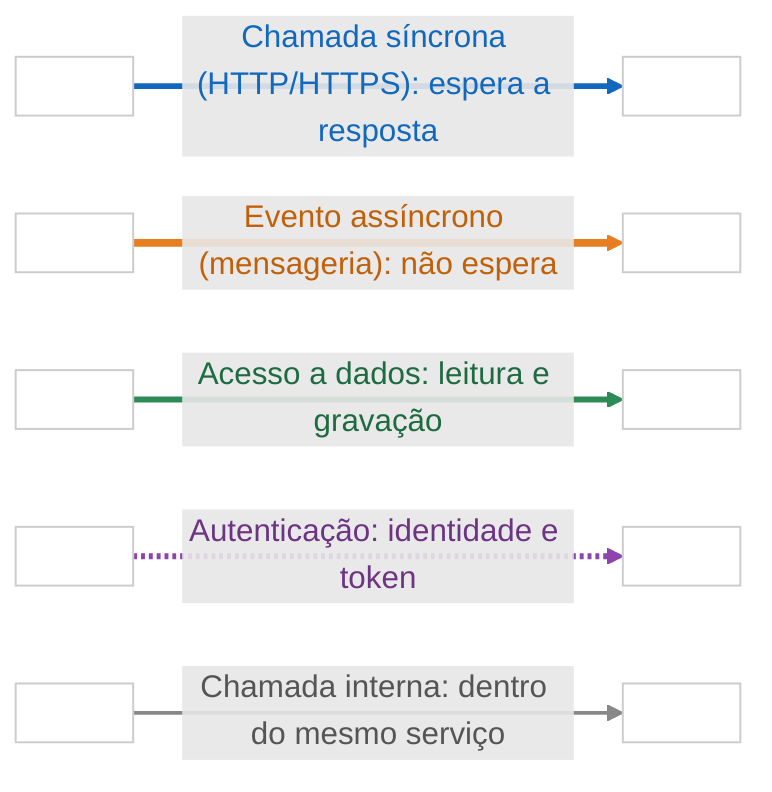
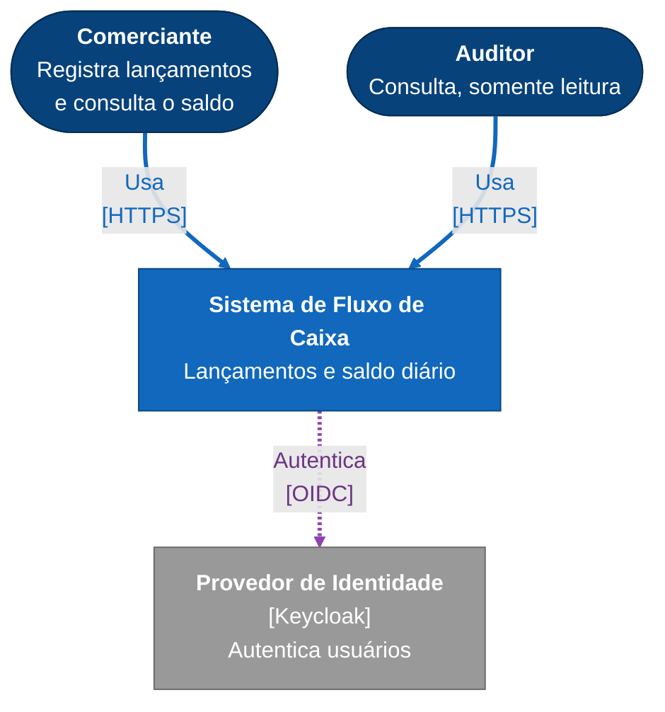
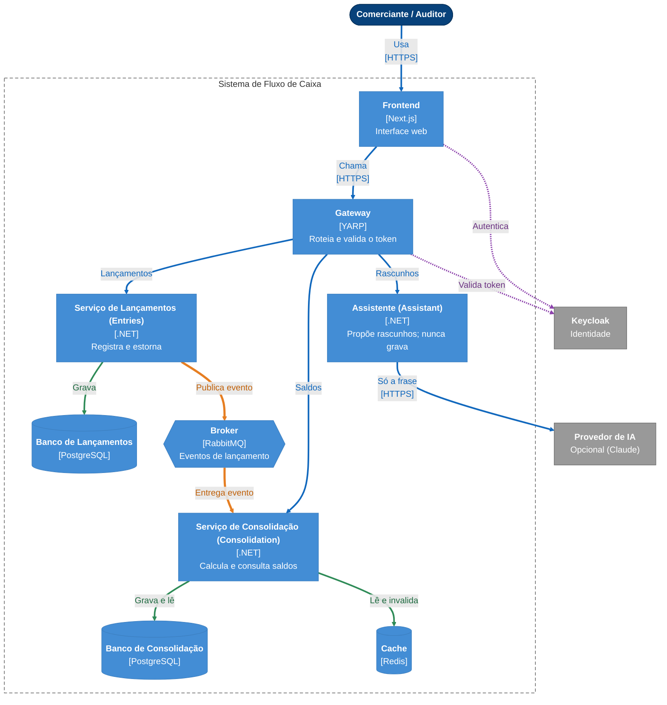
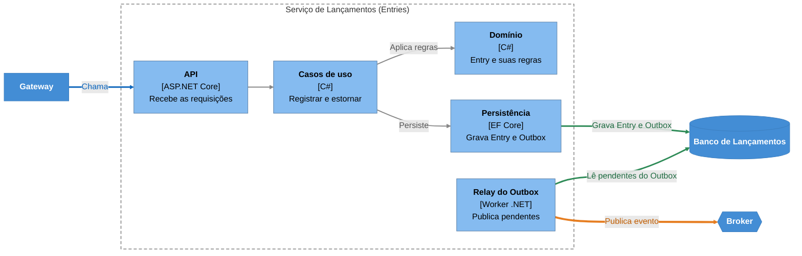
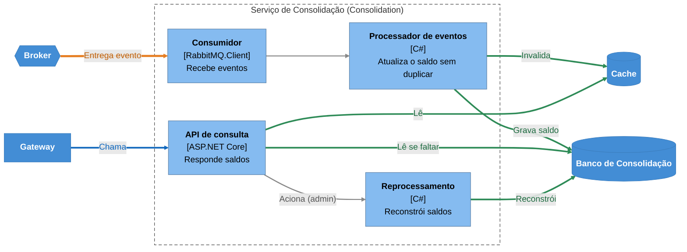
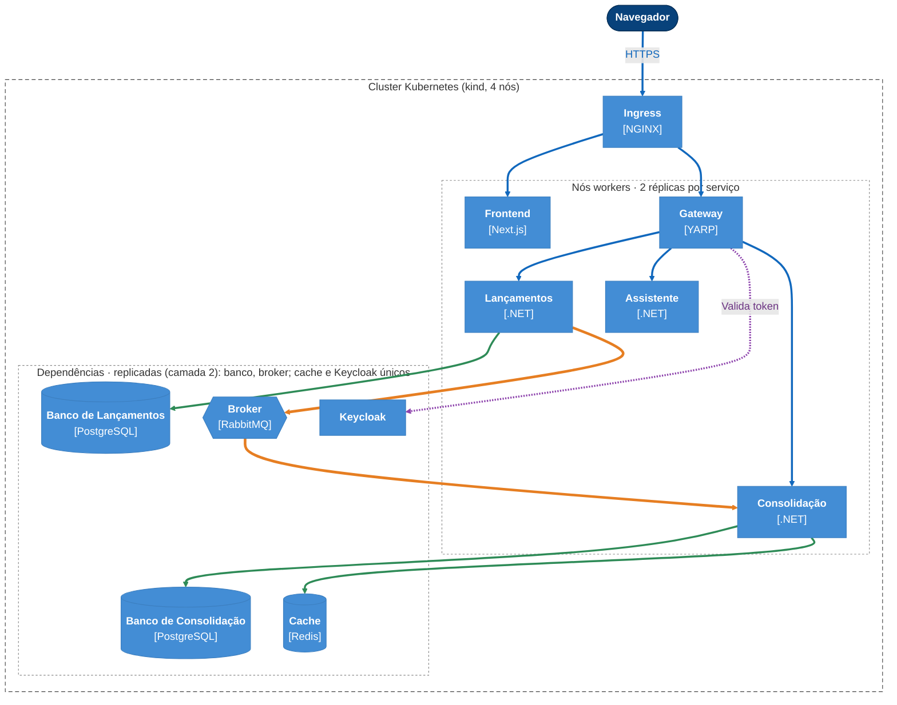

# Diagramas C4 (C4 Model)

> Notação C4 (Simon Brown): cada caixa traz **nome**, **tecnologia** e uma **descrição curta**. As **cores das caixas** dizem o tipo do elemento e as **cores das linhas** dizem o tipo de comunicação. Diagramas em Mermaid, versionados no repositório. Nomes em português; o termo em inglês aparece nos dois serviços, que são os nomes usados no código (ver o [glossário](../01-mapeamento-de-dominios.md#7-glossário-linguagem-ubíqua)). Explicação textual em [03 — Arquitetura alvo](../03-arquitetura-alvo.md).

## Legenda

### Caixas (tipo do elemento)

| Forma | Significado |
|---|---|
| Caixa com cantos arredondados | Pessoa, sistema, contêiner ou componente |
| Cilindro | Banco de dados ou cache |
| Hexágono | Fila / broker de mensagens |
| Linha tracejada em volta | Fronteira (boundary) |

### Linhas (tipo de comunicação)

| Cor e traço | Significado | Por que importa |
|---|---|---|
| Azul, contínua | Chamada síncrona (HTTP/HTTPS) | Quem chama espera a resposta; se o destino cai, o chamador sente |
| Laranja, grossa | Evento assíncrono (RabbitMQ) | Desacopla os serviços: o Lançamentos segue funcionando mesmo com a Consolidação fora |
| Verde, contínua | Acesso a dados (PostgreSQL, Redis) | Onde a informação é gravada ou lida |
| Roxa, tracejada | Autenticação (Keycloak, token JWT) | Caminho de segurança: quem é o usuário e o que ele pode fazer |
| Cinza, contínua | Chamada interna | Troca de objetos dentro do mesmo processo, sem rede |

Níveis usados: **1 (contexto)**, **2 (contêineres)**, **3 (componentes, só dos dois serviços do núcleo)** e uma visão de **implantação**. O nível 4 (código) não é desenhado: o próprio código o representa.

Preocupações transversais (telemetria com OpenTelemetry, Outbox, idempotência, protocolos internos) ficam na [arquitetura alvo](../03-arquitetura-alvo.md) e nas [ADRs](../adr/README.md), para manter os diagramas legíveis.

---

## Nível 1 — Contexto do sistema (System Context)

Quem usa o sistema e com o que ele conversa por fora.

---

## Nível 2 — Contêineres (Containers)

O que roda dentro do sistema e como as partes se falam. Repare nas duas cores no centro: a chamada **azul** (síncrona) chega aos serviços, e o caminho **laranja** (evento) liga os dois sem que um dependa do outro.

---

## Nível 3 — Componentes (Components)

### Serviço de Lançamentos (Entries)

O Relay do Outbox lê o que foi gravado e publica o evento. Por isso gravar o lançamento e avisar a Consolidação nunca ficam fora de sincronia.

### Serviço de Consolidação (Consolidation)

O caminho **laranja** alimenta o saldo; o caminho **azul** só consulta. Se o Redis faltar, a consulta cai para o banco.

---

## Implantação (Deployment)

Kubernetes local (kind, 4 nós). O mesmo desenho vale para a nuvem.

### Equivalência na nuvem

| Local (kind) | Nuvem (exemplo) |
|---|---|
| Cluster kind, 4 nós | Cluster Kubernetes gerenciado, nós em várias zonas |
| PostgreSQL (CloudNativePG na camada 2) | Banco gerenciado multi-AZ |
| RabbitMQ | Serviço gerenciado de mensageria |
| Redis | Cache gerenciado com réplica |
| Ingress NGINX | Load balancer + WAF |
| Secrets do Kubernetes | Gerenciador de segredos |
